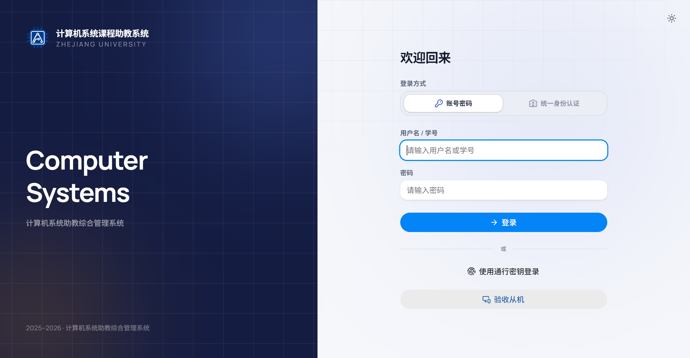
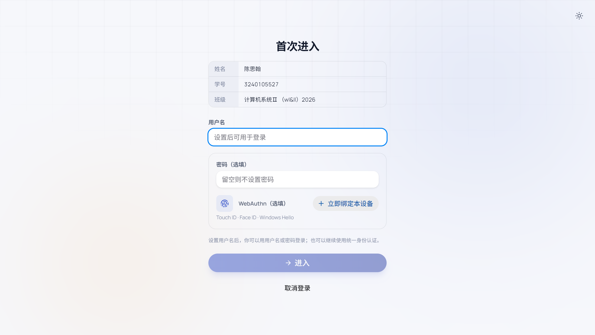

# 1. 账号开通、登录与首次进入

## 1.1 账号从哪里来

系统**没有公开的自助注册入口**。账号由课程名单或助教在课程内创建：

- 助教/教师账号：由管理员预先加入课程，或教师在「设置 → 系统设置 → 添加新助教」中按学号添加。
- 学生账号：随课程学生名单产生。学生首次登录后自行设置用户名；密码和通行密钥为可选项。
- 同一个学号可以出现在不同班级，但属于不同账号；登录时如果存在多个班级/身份，页面会让你选择。

如果你还没有账号，或名单里没有你的学号，请联系课程助教/管理员，而不是尝试注册。

## 1.2 登录页面

登录页左侧是系统介绍，右侧是登录面板。右上角可以切换深色/浅色主题。

可用的登录方式：

1. **账号密码**
   - 助教/教师：输入用户名或学号 + 密码。
   - 学生：输入学号（或已设置的用户名）+ 密码。
2. **统一身份认证**
   - 切换到「统一身份认证」，输入浙大统一身份认证账号和密码。
   - 适用于没有本地密码、或希望直接用学校账号登录的用户。
3. **通行密钥（Passkey）**
   - 已绑定过的设备可点击「使用通行密钥登录」，使用 Touch ID / Face ID / Windows Hello 验证。
   - 首次使用需先在「设置 → 个人信息 → 通行密钥」中绑定本设备。

页面底部还有一个独立入口：

- **验收从机**：进入 `/checkin`，用于手机或第二台设备配合主设备完成现场验收，详见[验收章节](4-checkoff.md)。

### 登录后的去向

- 助教/教师：默认进入 `/console` 总览。
- 学生：进入 `/student-console` 学生端概览。
- 如果账号还没有用户名，会先跳到首次完善信息页面。

### 上次登录用户

浏览器会记住上次登录的账号。再次打开登录页时，会直接显示「上次登录」卡片：

- 有通行密钥时显示「使用通行密钥继续」。
- 点击「其它登录方式」可用密码/统一身份认证登录。
- 点击「切换用户」回到完整登录表单。

## 1.3 助教/教师首次登录：完善信息

首次登录且账号没有用户名时，会进入「完善信息」页面。需要填写：

- **姓名（必填）**：实际作为登录用户名/显示名使用，建议使用真实姓名或常用昵称。
- **密码（选填）**：至少 8 位；不填也可以继续使用统一身份认证。
- **WebAuthn（选填）**：点击「立即绑定本设备」，按系统提示完成指纹/面容/Windows Hello 验证。

点击「完成」后进入总览。后续可以在「设置」中修改用户名、密码和通行密钥。

## 1.4 学生首次进入

学生第一次用学号/统一身份认证登录后，会进入「首次进入」页面：

页面会显示姓名、学号和所属班级，需要：

1. 设置一个**用户名**（设置后可用用户名或学号登录）。
2. 可选设置密码（至少 8 位）；不设置则继续使用统一身份认证。
3. 可选绑定本设备的通行密钥。
4. 点击「进入」完成，进入学生端概览。

如果发现姓名/班级不对，请先点击「取消登录」退出，再联系助教核对名单；不要用错误账号继续操作。

## 1.5 常见登录问题

| 现象 | 处理方式 |
| --- | --- |
| 提示用户名/密码错误 | 确认使用的是本课程账号；可改用统一身份认证；仍失败请联系助教重置 |
| 登录后要求选择班级 | 同一学号在多个班级有账号，选择本次要使用的班级 |
| 登录后进入「首次进入」 | 该学生账号尚未设置用户名，按页面提示完成即可 |
| 通行密钥不可用 | 可能是设备未绑定或凭据被删除，改用密码/统一身份认证登录，再重新绑定 |
| 页面一直停在加载 | 刷新页面；确认本地后端服务已启动；检查浏览器控制台是否有网络错误 |

> 密码和统一身份认证信息属于敏感信息。不要把密码写进报告、聊天记录或截图；使用公共电脑后请退出登录。
