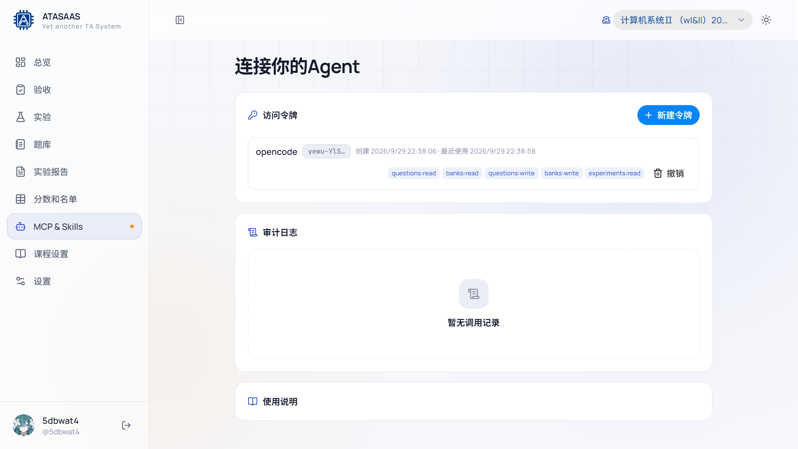

# 10. MCP & Skills

「MCP & Skills」用于把题库/题目集能力开放给支持 MCP 的 Agent（opencode、Cursor、VS Code、Claude Code 等）。页面左侧导航点击「MCP & Skills」。



## 10.1 访问令牌

### 新建令牌

点击「新建令牌」：

1. **名称**：备注用途，例如 `opencode`、`我的批改助手`。
2. **授权范围**（可多选）：
   - `questions:read`：读取题目（搜索、查看）。
   - `questions:write`：编辑题目（新建/修改/删除/复制）。
   - `banks:read`：读取题目集及其中的题目。
   - `banks:write`：编辑题目集（新建/重命名/删除/调整）。
   - `experiments:read`：读取班级实验和绑定的题目集。
3. **有效期**：30 天 / 90 天 / 1 年 / 永不过期。
4. 创建后，令牌**只显示一次**；请立即复制保存。

> 只授予实际需要的范围。例如只读 Agent 只给 `*:read`；不要给不需要写入的 Agent `*:write`。

### 令牌列表

- 名称、前缀（如 `yewu-YlS…`）、创建时间、最近使用时间。
- 授权范围标签。
- **撤销**：立即使令牌失效。

### 使用说明

页面下方会给出各客户端的配置示例。入口地址为：

```text
http://localhost:5173/mcp
```

请求头：

```text
Authorization: Bearer <你的令牌>
```

常见客户端：

- **opencode**：`opencode.json` 中配置 `type: remote`、`url` 和 `headers`；访问令牌模式需要 `"oauth": false`。
- **Cursor**：`~/.cursor/mcp.json` 的 `mcpServers`。
- **VS Code**：`.vscode/mcp.json` 的 `servers`，远程服务器写 `"type": "http"`。
- **Claude Code**：`.mcp.json`/`~/.claude.json`，远程条目需 `"type": "http"`；也支持命令行添加。

页面还提供「复制 Agent 提示词」：把服务器地址和令牌一起发给 Agent，让 Agent 自动列出可用工具。

## 10.2 审计日志

页面下方显示 MCP 工具调用记录：

- 时间、令牌名称、工具名、是否成功、错误信息。
- 没有调用时显示「暂无调用记录」。
- 可用于排查 Agent 调用了什么、是否越权或失败。

## 10.3 Agent 可以做什么

在授权范围内，Agent 通常可以：

- 搜索/读取题目；
- 新建、修改、复制、删除题目；
- 列出/读取题目集；
- 新建、重命名、复制、删除题目集；
- 向题目集追加/移除题目、设置题目集内容；
- 列出实验及其绑定题目集。

具体工具列表以 Agent 连接后返回的 `tools/list` 为准。

## 10.4 安全建议

- 令牌等同于账号权限，不要提交到 Git、不要发到群聊。
- 为不同用途创建不同令牌，便于单独撤销。
- 定期检查「最近使用」和审计日志。
- 不再使用时及时撤销。
- 如果怀疑泄露，立即撤销并重新创建。
