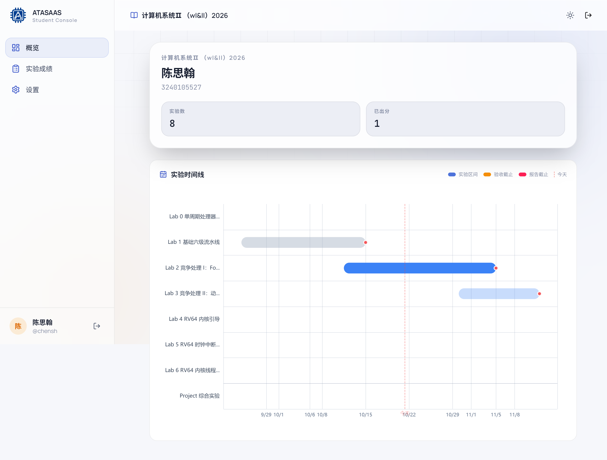
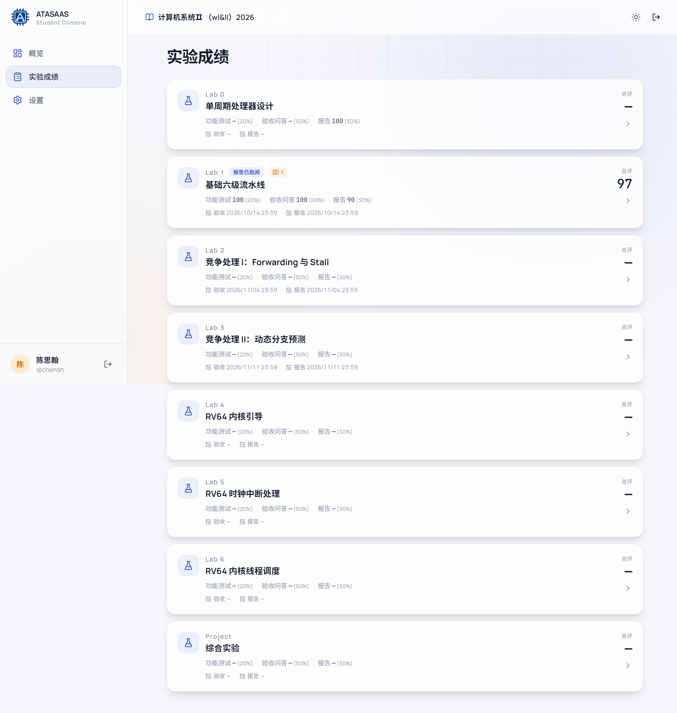
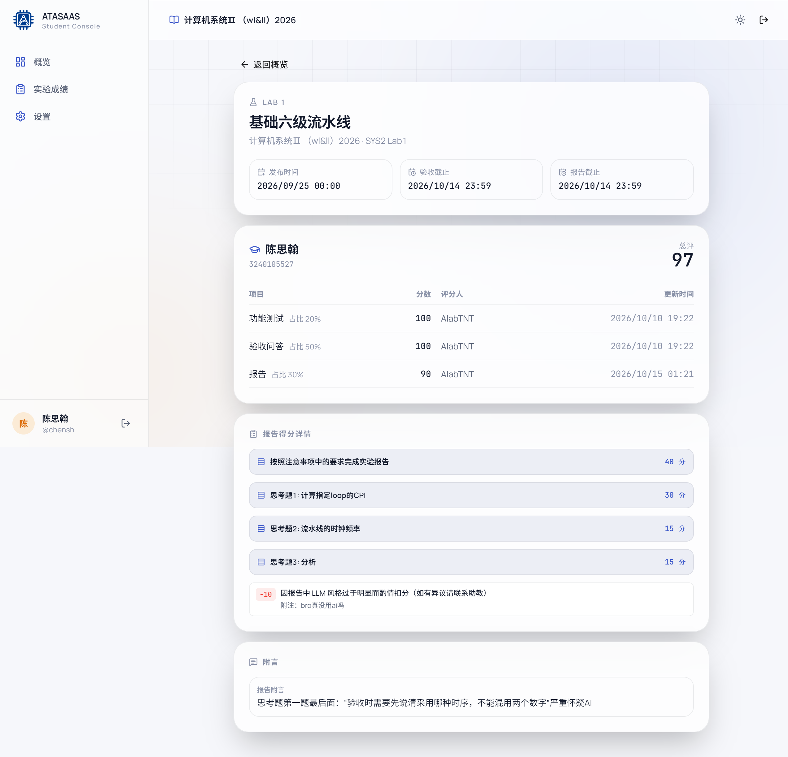
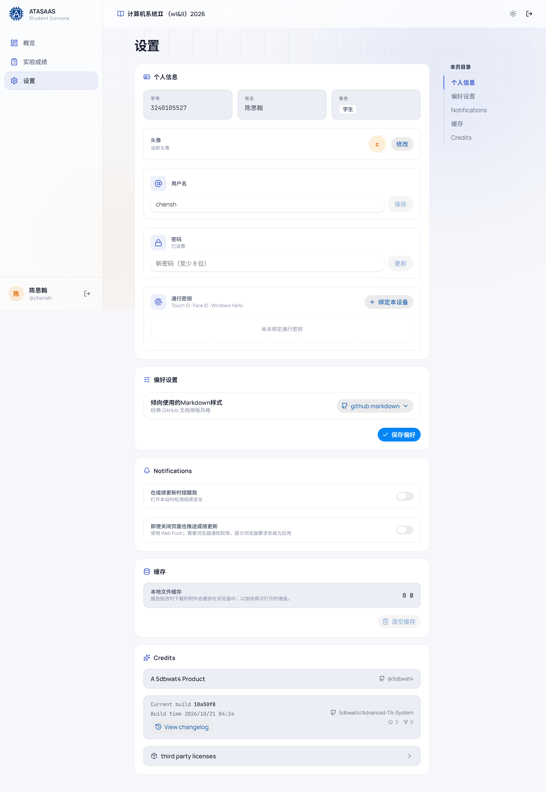

# 11. 学生端

学生登录后进入 `/student-console`，左侧有「概览」「排队验收」「实验成绩」「设置」四个入口。学生端不能修改成绩或题库；「排队验收」只用于排队和取消排队。

## 11.1 概览

- 顶部显示课程名称、姓名、学号。
- 统计卡片：
  - **实验数**：当前课程实验总数。
  - **已出分**：已经有总评的实验数量。
- **实验时间线**：
  - 每个实验一条横向区间。
  - 蓝色区间表示实验周期；黄色/红色标记验收截止、报告截止。
  - 虚线是"今天"。
  - 点击时间线上的实验条可以进入该实验的成绩详情。

时间线适合快速判断"现在该做哪个实验、什么时候截止"。

## 11.2 实验成绩

按实验列卡片，每张卡片显示：

- 实验编号和标题。
- 状态标签：如「报告已批阅」、附言数量。
- 三项分数及占比：功能测试、验收问答、报告。
- 验收截止和报告截止时间。
- 右侧大号数字是**总评**；未出分显示 `—`。

点击卡片进入该实验详情。

## 11.3 实验成绩详情

页面显示：

- 实验标题、课程、时间线（发布时间/验收截止/报告截止）。
- 学生姓名和学号。
- **总评**。
- **项目明细表**：

| 项目 | 分数 | 占比 | 评分人 | 更新时间 |
| --- | --- | --- | --- | --- |
| 功能测试 | 100 | 20% | 助教 | … |
| 验收问答 | 100 | 50% | 助教 | … |
| 报告 | 90 | 30% | 助教 | … |

- **报告得分详情**：如果报告按评分标准批改，会逐项列出每个小节的得分（如"按照注意事项中的要求完成实验报告 40 分"）、扣分项和说明。
- **附注**：评分标准中的附加说明。
- **附言**：
  - 验收附言
  - 报告附言

如果看不到报告详情，说明该报告还没有按评分标准批改或评分标准未公开详情。

## 11.4 学生设置

- **个人信息**：学号、姓名、角色、头像、用户名、密码、通行密钥。
- **偏好设置**：Markdown 样式。
- **Notifications**：
  - 打开本站时检测成绩变化。
  - 即使关闭页面也推送成绩更新（Web Push，需要浏览器通知权限）。
- **缓存**：清空本地报告附件缓存（不影响服务器）。
- **Credits**。

## 11.5 排队验收

入口：左侧导航「排队验收」，或直接访问 `/student-console/queue`。页面只列出当前**开放验收**的实验（已发布，且验收尚未截止）；未开放或已截止的实验不会显示。

每张实验卡片显示实验编号、标题、验收截止时间、当前排队人数，以及你的排队状态：

| 状态 | 页面显示 | 可执行操作 |
| --- | --- | --- |
| 未排队 | 「未排队」 | 「加入队列」 |
| 排队中 | 「排队中 · 第 N 位」「前面还有 M 人」/「已排到最前」·「已等待 X 分钟」 | 「取消排队」 |
| 已完成验收 | 「已完成验收」 | 「重新排队」 |

- 加入后提示「已加入 Lab 1 排队」，取消后提示「已取消 Lab 1 排队」。
- 位次按加入队列的时间排序；「已等待」不足 1 分钟显示「不到 1 分钟」，超过 1 小时按小时显示（如「1 小时 20 分钟」）。
- 页面每 15 秒自动刷新一次，切回该页面标签时也会立即刷新；也可以点右上角刷新按钮手动刷新。
- 学生不能选择助教：队列按班级共享，所有助教看到的是同一个队列。线上排队只决定顺序，叫号由助教**线下**完成，请留意现场。
- 助教保存你该实验的验收成绩后，你会被**自动移出队列**，页面会提示「已完成 Lab 1 验收，已自动移出队列」。
- 「已完成验收」表示该实验已有验收成绩；如需再次验收，点「重新排队」即可重新加入。
- 如果账号还没有绑定班级，页面会提示「未绑定班级」，请联系助教绑定后再使用。

## 11.6 学生常见问题

| 问题 | 处理方式 |
| --- | --- |
| 登录后要求设置用户名 | 首次进入必须设置用户名，按页面提示完成 |
| 看不到某个实验 | 确认班级正确；实验可能还未公开或已被移出名单 |
| 分数显示 `—` | 该项目尚未录入/批改；总评需要三项都齐才计算 |
| 报告详情为空 | 报告可能只给了总分，没有使用评分标准逐项批改 |
| 想修改成绩 | 学生端不能改分，请联系对应助教 |
| 收不到成绩通知 | 检查浏览器通知权限；部分浏览器需要安装为应用才能 Web Push |
