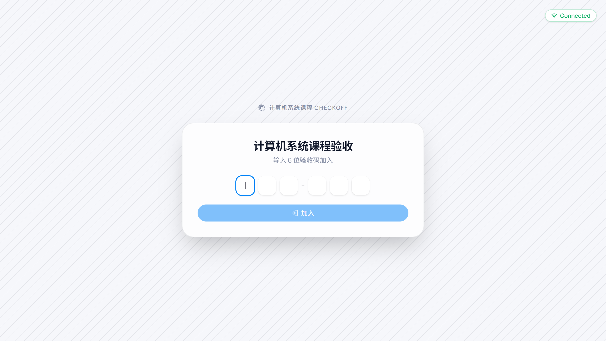
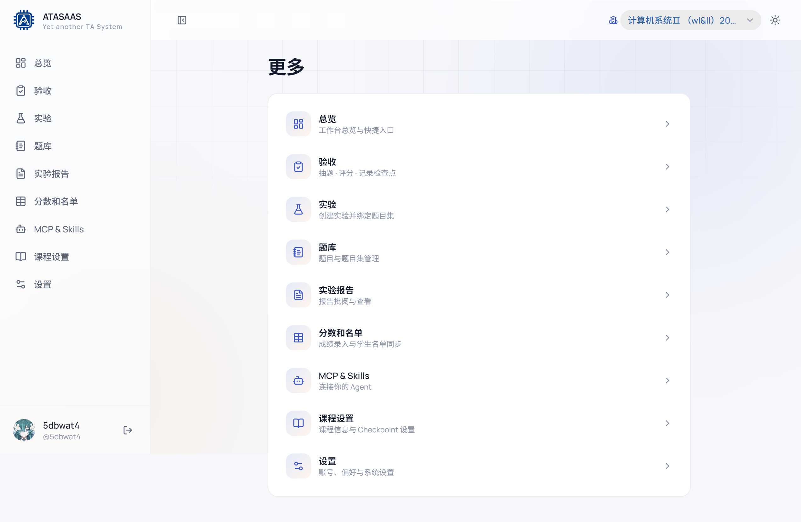

# 12. 其他功能与使用建议

## 12.1 验收从机

从机用于双设备验收：主设备负责展示/抽题，从机负责评分或辅助查看。

入口：

- 登录页底部「验收从机」。
- 直接访问 `http://localhost:5173/checkin`。

使用步骤：

1. 主设备进入「验收」，顶部显示 6 位配对码和从机链接。
2. 从机打开链接或在 `/checkin` 输入配对码，点击「加入」。
3. 主设备显示从机已连接。
4. 在主设备上选择实验、学生、抽题，从机同步显示。
5. 验收结束后关闭从机页面。

如果连接失败：

- 确认主设备验收页仍打开且配对码未过期；
- 确认网络能访问主设备地址（同一局域网）；
- 刷新从机页面重新加入。

## 12.2 移动端「更多」

在手机/窄屏上，底部导航只保留：

- 总览
- 实验
- 题库
- 实验报告
- 分数和名单

其余入口（验收、MCP & Skills、课程设置、设置、开发板等）收进「更多」：

「更多」页按卡片列出所有功能及说明，点击即可进入。

## 12.3 主题与显示

- 顶栏右侧太阳/月亮图标切换深色/浅色主题。
- 主题会应用到 Markdown 预览、代码高亮、图表等组件。
- 侧边栏可以折叠，适合投影/小屏。

## 12.4 页面路径速查

| 功能 | 路径 |
| --- | --- |
| 登录 | `/login` |
| 总览 | `/console` |
| 验收 | `/console/checkoff` |
| 自定义 Card | `/console/checkoff/cards` |
| 特殊抽题 | `/console/checkoff/special` |
| 实验列表 | `/console/experiments` |
| 实验详情 | `/console/experiments/:id` |
| 题库 | `/console/questions` |
| 题目集管理 | `/console/questions/banks/:id/manage` |
| 实验报告 | `/console/reports` |
| 报告批改 | `/console/reports/:id` |
| 评分标准管理 | `/console/criteria` |
| 分数和名单 | `/console/scores` |
| 独立计分项目 | `/console/scores/standalone` |
| 课程设置 | `/console/courses/settings` |
| Checkpoint 名单 | `/console/courses/checkpoints` |
| 重点关注学生 | `/console/courses/focus-students` |
| 开发板 | `/console/boards` |
| MCP & Skills | `/console/llm-connect` |
| 个人设置 | `/console/settings` |
| 学生端概览 | `/student-console` |
| 学生端成绩 | `/student-console/scores` |
| 学生排队验收 | `/student-console/queue` |
| 验收从机 | `/checkin` |

## 12.5 常见问题

### Q1：为什么没有注册按钮？

系统不开放自助注册。账号来自课程名单或助教添加；首次登录只负责设置用户名/密码。

### Q2：为什么我的课程和别人的不一样？

账号绑定在具体班级上。顶栏「选择班级」只显示当前账号可访问的课程；同一学号在不同班级是独立账号。

### Q3：为什么验收页没有题目？

实验没有绑定题目集，或题目集是空的。到「实验详情 → 抽题题目集」绑定，或在题库中给题目集加题。

### Q4：为什么成绩表里没有某个学生？

名单可能还没更新。到「分数和名单 → 更新名单」预览并应用；仍没有则联系管理员。

### Q5：报告提交列表为空？

报告列表读取自学在浙大作业，可能尚未绑定、尚未提交或上游获取失败。确认实验详情中的报告作业绑定。

### Q6：总分怎么算？

总评按加权平均计算：`(功能测试×权重 + 验收问答×权重 + 报告×权重) / 权重之和`。权重来自课程统一设置或实验单独设置（例如 2:5:3 对应 20%/50%/30%）。

### Q7：修改评分标准会影响谁？

会影响所有使用该分享码的报告。批量修改前建议「另存为」新标准，再逐步切换。

### Q8：为什么不能删除某个评分标准？

它正在被报告使用。先替换这些报告的评分标准，或保留它。

### Q9：学在浙大相关按钮可以直接点吗？

读取提交列表/作业信息通常可以直接使用；**推送/回写成绩**属于外部写操作，本手册没有演示，请按课程管理员流程操作。

### Q10：截图里的姓名/分数是真实的吗？

不是。手册使用本地演示数据，仅用于说明界面和操作。

## 12.6 操作习惯建议

- 每次开始验收前确认：课程正确、实验正确、题目集非空、评分占比正确。
- 报告批改先设置评分标准，再批量处理未批改学生。
- 批量修改题目集/评分标准前，先看"使用中 N 处"。
- 重要操作（评分、附言、成绩）保存后，回到列表确认状态已更新。
- 公共电脑使用后退出登录，并清理浏览器缓存中的报告附件。
