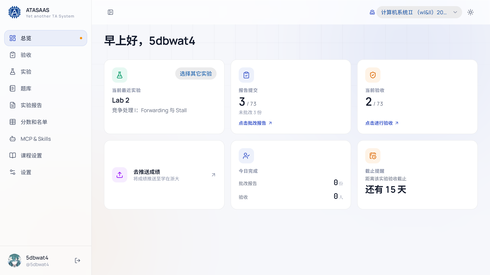

# 2. 总览（工作台）

登录助教/教师账号后默认进入「总览」。总览用于快速了解当前课程最近一次实验的批改、验收和截止情况，并提供常用入口。

## 2.1 页面结构

### 顶部栏

- **折叠侧边栏**：给主内容让出更多横向空间。
- **选择班级**：显示当前课程名称；点击可切换其它已绑定课程。总览、实验、题库、成绩等页面都会跟随当前课程。
- **主题切换**：深色/浅色模式。

### 第一行卡片

1. **当前最近实验**
   - 默认显示当前进行中/最近需要处理的实验（如 `Lab 2`）。
   - 点击右上角「选择其它实验」可以切换，其它卡片会随之更新。
2. **报告提交**
   - 显示"已提交 / 总人数"，例如 `3 / 73`。
   - 下方显示未批改份数。
   - 点击卡片进入该实验的报告批改页。
3. **当前验收**
   - 显示该实验已完成验收的学生数 / 总人数。
   - 点击进入验收页。

### 第二行卡片

4. **去推送成绩**
   - 进入该实验的学在浙大推送页面。
   - **本手册不演示实际推送**；请按课程管理员要求操作。
5. **今日完成**
   - 统计"我"今天作为评分人更新的报告份数和验收人数。
   - 用于快速确认自己今天的批改工作量。
6. **截止提醒**
   - 取最近一个未来截止时间，显示"还有 N 天"。
   - 如果全部截止时间都过去了，显示"已截止 N 天"。

## 2.2 常见用法

- **开始验收**：在「当前验收」卡片点击「点击进行验收」，或在左侧导航点击「验收」。
- **批改报告**：在「报告提交」卡片点击「点击批改报告」。
- **查看某个实验整体情况**：先「选择其它实验」，再查看报告/验收/截止卡片。
- **确认今天做了什么**：「今日完成」只统计当前登录账号作为评分人的记录，换账号后数字会变化。

## 2.3 没有数据时

- 如果课程尚未绑定，页面会提示「尚未绑定班级」，请先在「设置 → 系统设置 → 助教绑定课程」中绑定。
- 如果当前课程还没有实验，卡片会显示「暂无实验」，请先到「实验」页新建实验。
- 如果报告/验收统计显示 `—`，通常是上游提交列表获取失败或该实验还没绑定学在浙大作业；不影响本地成绩查看。

## 2.4 导航说明

桌面端左侧导航固定显示：

| 导航 | 用途 |
| --- | --- |
| 总览 | 当前实验进度和快捷入口 |
| 验收 | 现场抽题、展示 demo、评分 |
| 实验 | 新建/管理实验、绑定题目集、查看学生得分 |
| 题库 | 题目和题目集管理 |
| 实验报告 | 报告提交列表与批改入口 |
| 分数和名单 | 全课程成绩表、独立计分项目、名单同步 |
| MCP & Skills | 创建访问令牌，让 Agent 读写题库 |
| 课程设置 | Checkpoint、评分占比、重点关注、开发板、评语模板 |
| 设置 | 个人账号、密码、通行密钥、偏好和系统设置 |

移动端底部只保留总览、实验、题库、实验报告、分数和名单，其余入口收进「更多」。
