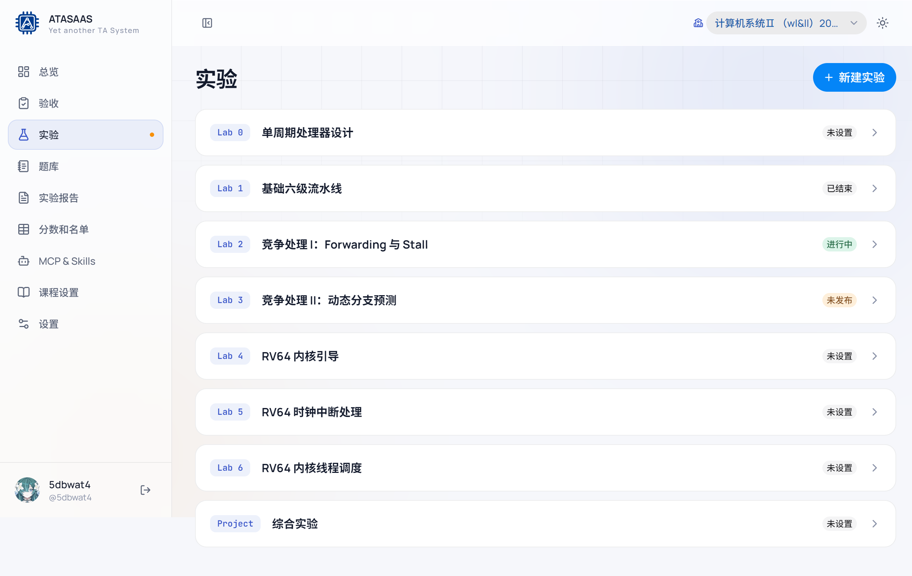
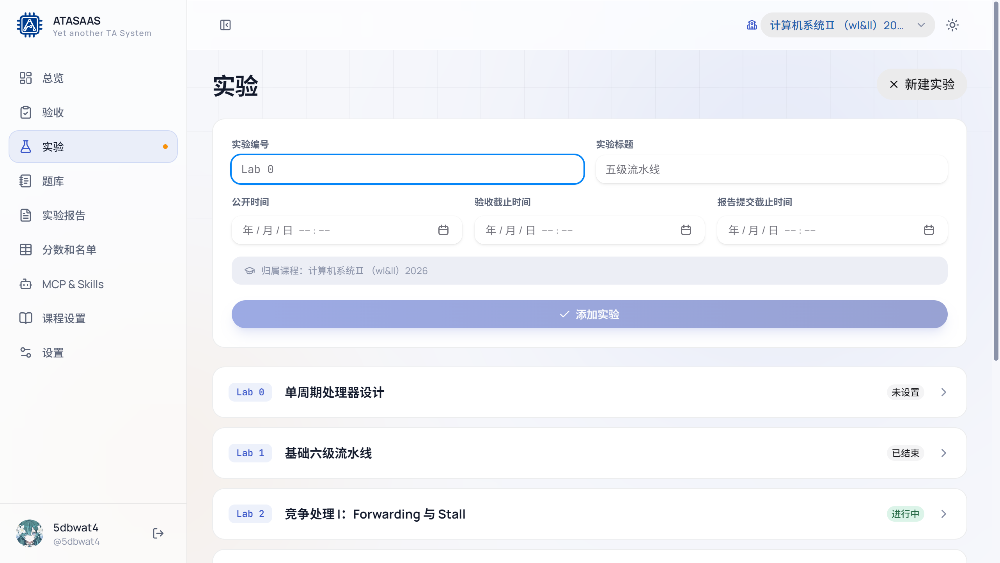
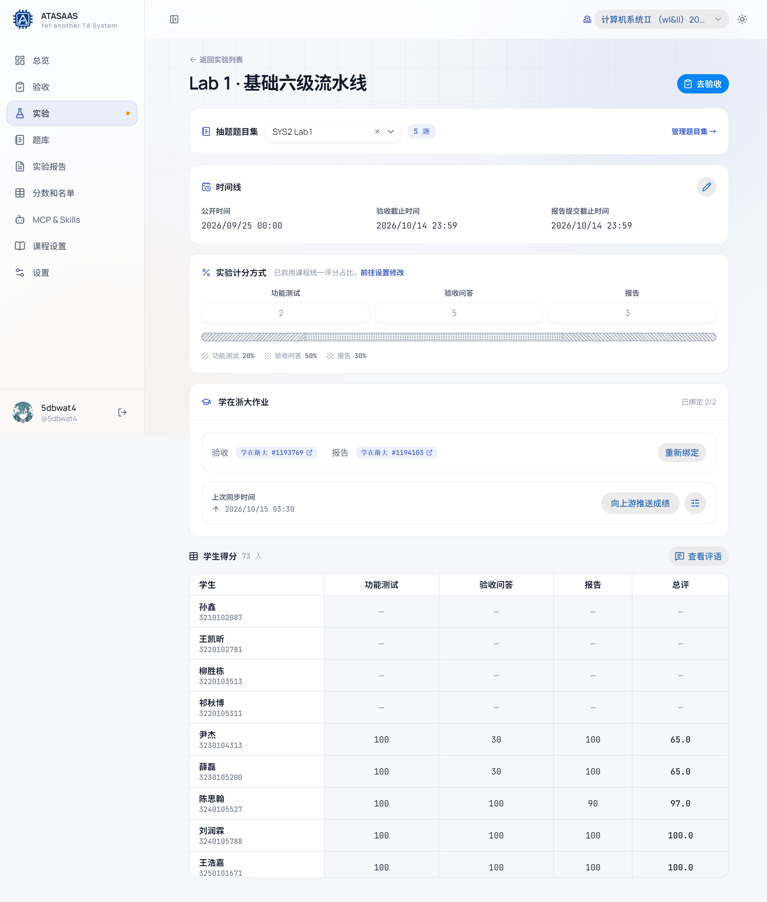
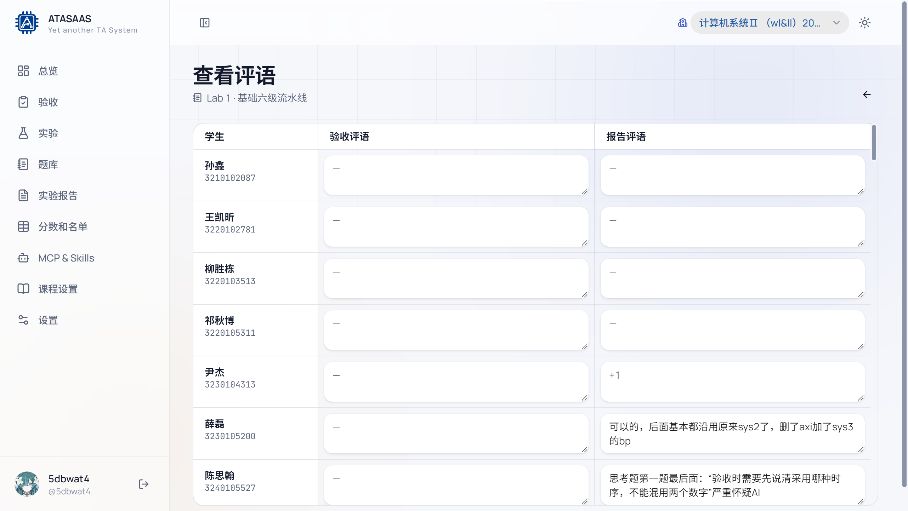

# 3. 实验管理

「实验」页面负责一次实验的基本信息、时间线、抽题题目集、评分占比和学在浙大作业绑定。验收、报告和成绩都围绕实验展开。

## 3.1 实验列表

每个实验卡片显示：

- **实验编号**（如 `Lab 1`）和**标题**。
- **状态标签**：根据时间线自动计算。
  - **未设置**：没有公开时间/截止时间。
  - **未发布**：公开时间还没到。
  - **进行中**：已公开且未过截止时间。
  - **已结束**：已过截止时间。
- 点击卡片进入实验详情。

右上角「新建实验」用于创建实验。

## 3.2 新建实验

点击「新建实验」展开表单：

1. **实验编号**：建议使用 `Lab 0`、`Lab 1`、`Project` 这类短编号，同一课程内不能重复。
2. **实验标题**：如「基础六级流水线」。
3. **公开时间**：学生端时间线的起点。
4. **验收截止时间**：现场验收的截止时间。
5. **报告提交截止时间**：报告提交的截止时间。
6. **归属课程**：自动取当前选中的课程，不可在表单里修改。
7. 点击「添加实验」。

> 时间可以留空；留空的实验会显示「未设置」，不会自动出现在学生端的有效时间线区间里。

## 3.3 实验详情

实验详情从上到下分为几块。

### 顶部

- **返回实验列表**。
- 实验标题（`Lab 1 · 基础六级流水线`）。
- **去验收**：带着当前实验跳转到验收页。

### 抽题题目集

- 下拉框显示当前绑定的题目集及题目数量。
- 点击下拉可切换题目集；选择后立即保存。
- 「管理题目集 →」跳转到题库的题目集页。
- 如果没有绑定题目集，验收页将无法抽题。

### 时间线

- 显示公开时间、验收截止时间、报告提交截止时间。
- 点击「编辑时间线」可以就地修改三个时间并保存。

### 实验计分方式

- 显示功能测试、验收问答、报告三项的权重和折算百分比。
- 如果课程开启了「统一评分占比」，这里只读，并提示「前往设置修改」。
- 如果课程关闭统一占比，可以在这里单独调整本实验的权重。
- 权重变化后会自动保存（有短暂防抖），页面上的总评会重新计算。

### 学在浙大作业

- 显示验收/报告作业的绑定状态（如「已绑定 2/2」）和作业编号链接。
- 「重新绑定」可选择该课程下的作业。
- 「上次同步时间」和「向上游推送成绩」：属于学在浙大同步/推送能力，**本手册不演示实际推送**。
- 「偏好设置」可打开验收偏好弹窗。

### 学生得分

- 以表格列出本实验所有学生。
- 列为：学生、功能测试、验收问答、报告、总评。
- 总评按当前评分占比加权计算；未录入的项目显示 `—`。
- 「查看评语」进入该实验的批量评语页。

## 3.4 批量评语页

从实验详情点击「查看评语」进入。页面按学生列出两列：

- **验收评语**（验收时填写的附言）。
- **报告评语**（报告批改时填写的附言）。

直接在单元格中输入即可，停止输入约 0.8 秒后自动保存；失焦也会立即保存。右上角会显示「保存中…」。

这些评语会被评语模板中的 `{@REMARK}` 引用，也会显示在学生端的成绩详情里。

## 3.5 推荐操作顺序

1. 新建实验并设置时间线。
2. 到题库准备题目集。
3. 回到实验详情绑定题目集。
4. 在课程设置中确认统一评分占比（或单独设置本实验占比）。
5. 验收 → 批改报告 → 在「分数和名单」中核对总评。
6. 如需同步学在浙大，按管理员流程在实验详情/便捷工具中操作（本手册不演示推送）。
