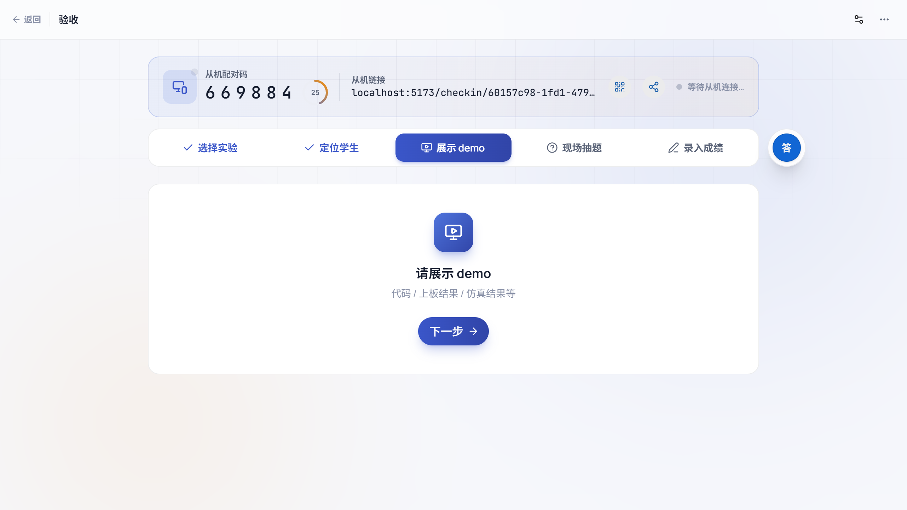
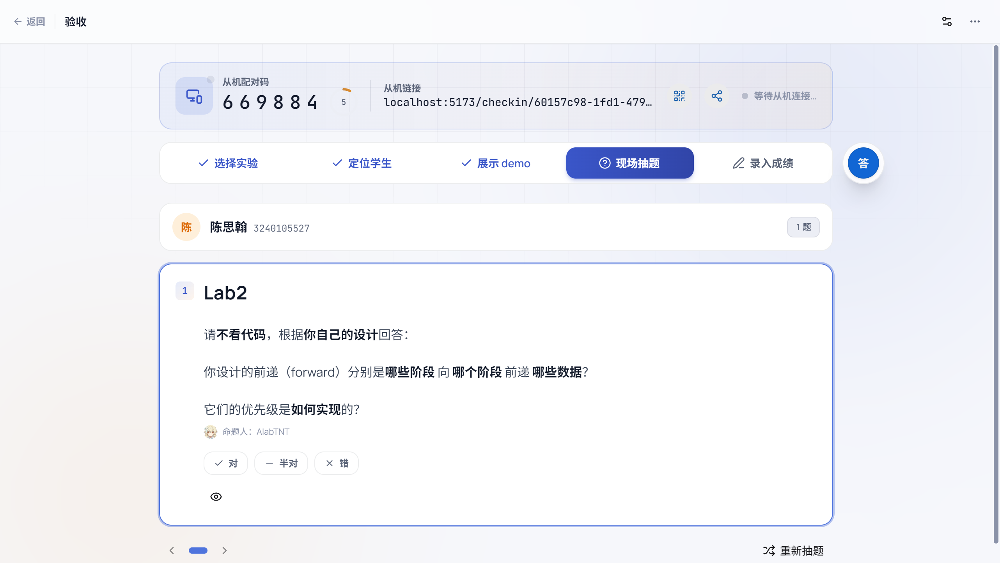
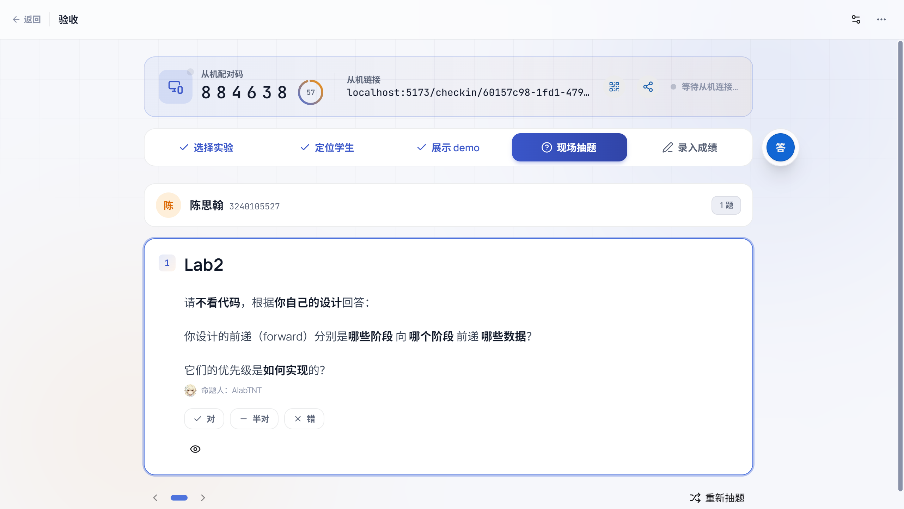
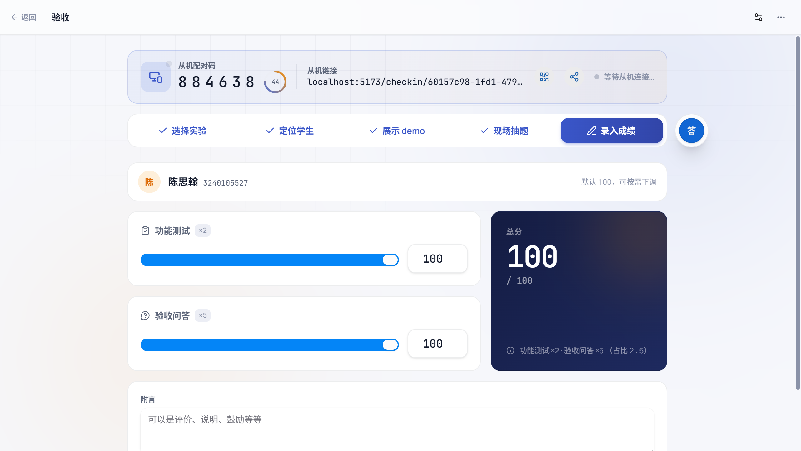
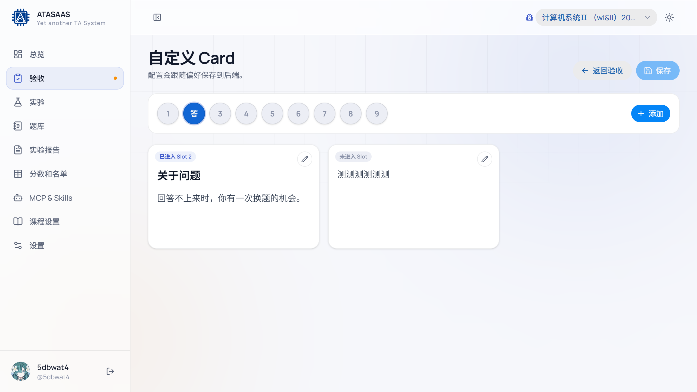
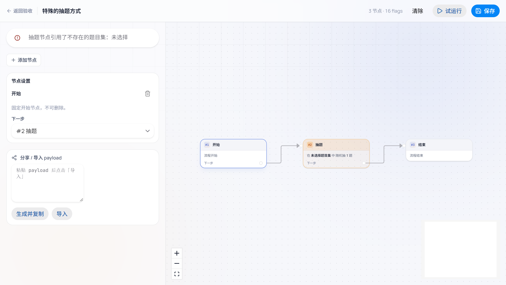
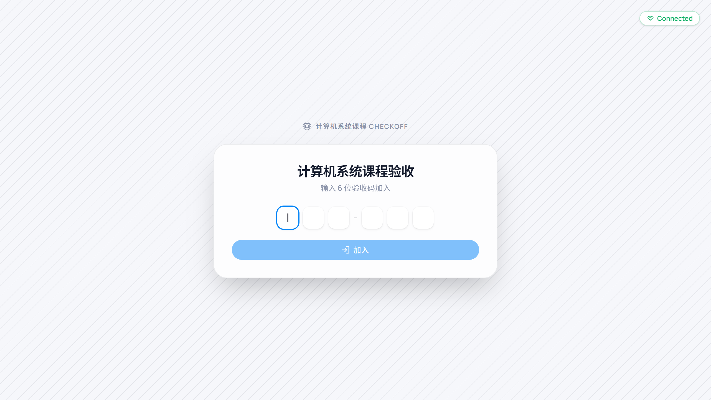

# 4. 验收（Checkoff）

验收页是助教现场使用频率最高的页面：选择实验 → 定位学生 → 看 demo → 现场抽题 → 录入成绩。页面顶部始终显示当前步骤，底部/右侧根据步骤切换内容。

## 4.1 进入验收

有三种方式：

1. 左侧导航「验收」。
2. 总览「当前验收」卡片。
3. 实验详情右上角「去验收」（会自动带入该实验）。

## 4.2 顶部工具区

### 从机配对

页面顶部显示：

- **从机配对码**：6 位数字。
- **从机链接**：形如 `localhost:5173/checkin/<uuid>`。
- **显示二维码 / 分享从机网址**：让第二台设备扫码或打开链接。
- **等待从机连接…**：有从机加入后显示连接状态。

双设备模式下，一台设备负责抽题/展示，另一台负责评分；从机加入后会自动跟随主设备状态。

### 实验与操作

- **选择实验**：回到第 1 步，重新选择实验。
- **定位学生**：回到第 2 步，重新搜索学生。
- **展示 demo**：跳到第 3 步。
- **现场抽题**：跳到第 4 步。
- **录入成绩**：跳到第 5 步。
- **更多菜单**：
  - 「谁在验收」：查看当前课程正在进行的验收记录/在场情况。
  - 「使用其它题目集」：临时覆盖本实验绑定的题目集，只影响当前验收。
  - 「使用某种抽题方式」/特殊抽题：进入或应用特殊抽题状态机。
  - 显示/隐藏从机配对信息。
- **偏好**：打开验收偏好设置（单设备/多设备、随机/固定抽题、抽题数量、自定义 Card、Markdown 编辑器/样式）。
- **切换到自定义 Card / 答 悬浮按钮**：显示右侧 Card 轨道。

### 五步指示器

| 步骤 | 说明 |
| --- | --- |
| 1 选择实验 | 选择本次要验收的实验 |
| 2 定位学生 | 按姓名/拼音/学号搜索学生 |
| 3 展示 demo | 要求学生展示代码、上板结果或仿真结果 |
| 4 现场抽题 | 随机抽题或手动选题，逐题判定 |
| 5 录入成绩 | 调整功能测试/验收问答分数并保存 |

已完成的步骤会显示对勾，可以直接点击回退。

## 4.3 第 1 步：选择实验

页面会列出当前课程的所有实验，并显示每个实验绑定的题目数量：

- `Lab 0 单周期处理器设计 0 题`
- `Lab 1 基础六级流水线 5 题`
- …

选择有题目的实验即可进入下一步。如果显示「0 题」，说明该实验还没有绑定题目集，请先到实验详情绑定。

## 4.4 第 2 步：定位学生

- 搜索框支持**姓名、拼音、学号**。
- 右侧显示 `已找到 / 总人数`，例如 `73 / 73`。
- 学生列表会显示已完成验收的简要成绩（如「功能 100 · 问答 99」）。
- 点击学生即进入该学生的验收流程。

学生卡片上会显示当前实验已有的功能测试/验收问答成绩（如果有），方便确认是否重复验收。

## 4.5 第 3 步：展示 demo

页面提示：

> 请展示 demo
> 代码 / 上板结果 / 仿真结果等

确认学生展示后点击「下一步」进入抽题。

## 4.6 第 4 步：现场抽题

根据偏好设置，有两种模式：

- **随机抽题**：点击学生卡片上的「现场抽题」，按设定的抽题数量随机抽题。
- **固定选题**：从题目集里手动选择要问的题。

抽题后显示题目卡片：

- 题目内容（Markdown 渲染）。
- 命题人。
- **对 / 半对 / 错** 三个判定按钮。
- **显示答案**：展开参考答案，供助教核对。
- **上一题 / 第 N 题 / 下一题**：多题时切换。
- **重新抽题**：换一组题。
- **跳过抽题**：不抽题，直接进入评分。

判定结果会用于提示和记录；最终分数在第 5 步统一调整。

## 4.7 第 5 步：录入成绩

页面显示：

- 学生姓名和学号。
- **功能测试** 滑块/数字输入（0–100）。
- **验收问答** 滑块/数字输入（0–100）。
- **总分**：按当前实验的评分占比加权计算，并显示「功能测试 ×2 · 验收问答 ×5（占比 2 : 5）」。
- **附言**：可填写评价、说明、鼓励等。验收附言可在「查看评语」中批量查看。
- 底部：
  - 左侧提示 `Ctrl + ↵` 快捷键「保存并继续」。
  - 右侧主按钮 **保存并下一位**：保存当前学生后清空当前抽题/评分状态，并回到「定位学生」步骤，方便直接选择下一位学生。

默认分数是 100，可按需下调。只有点击保存后才会写入本地成绩。

## 4.8 自定义 Card（右侧轨道）

在验收页点击「切换到自定义 Card」或右侧悬浮的「答」按钮，会展开 Card 轨道：

- 顶部是 9 个 slot（1、2、3 … 9，其中一个可显示为「答」）。
- 下方是若干 Card；可以把 Card 拖入 slot，也可以左右拖动排序。
- 点击已进入 slot 的 Card 可在验收页展示；再次点击 slot 的关闭按钮可取消展示。
- 点击「添加」新建 Card，点击 Card 右上角「编辑 Card」修改名称和内容。
- 点击「保存」保存配置（跟随个人偏好保存）。

适合放置常用提示、评分说明、常见问题、鼓励语等。Card 内容支持 Markdown。

## 4.9 特殊抽题（进阶）

从「更多 → 使用某种抽题方式」进入特殊抽题介绍，再点击编辑进入状态机编辑器：

- 左侧是节点设置：开始、抽题、结束等节点。
- 可以添加节点、设置「下一步」、删除节点。
- 抽题节点可以指定题目集、随机数量和后续流向。
- 「试运行」预览抽题结果。
- 「保存」应用；「清除」恢复普通抽题。
- 右侧「分享 / 导入 payload」可复制状态机 JSON 或导入他人配置。

如果只是普通验收，不需要使用特殊抽题。

## 4.10 验收从机

从机用于双设备协作。打开方式：

- 登录页底部「验收从机」。
- 或直接访问 `/checkin`。

使用流程：

1. 主设备在验收页顶部获取 6 位配对码或从机链接/二维码。
2. 从机打开链接，或输入 6 位验收码，点击「加入」。
3. 主设备顶部显示从机已连接，之后抽题/评分状态会同步。
4. 验收结束后关闭从机页面或返回主设备继续。

> 从机只负责显示和配合操作，实际成绩仍以主设备保存结果为准。

## 4.11 验收小贴士

- 先确认顶部课程和实验正确，再开始找学生。
- 如果题目数量为 0，不要开始抽题，先绑定题目集。
- 评分前先看清楚「总分」的权重是否符合课程要求。
- 附言会进入评语模板和学生端，尽量写清楚、可执行。
- 双设备模式适合"一台展示题目、一台评分"，单设备模式则在同一页面完成。
