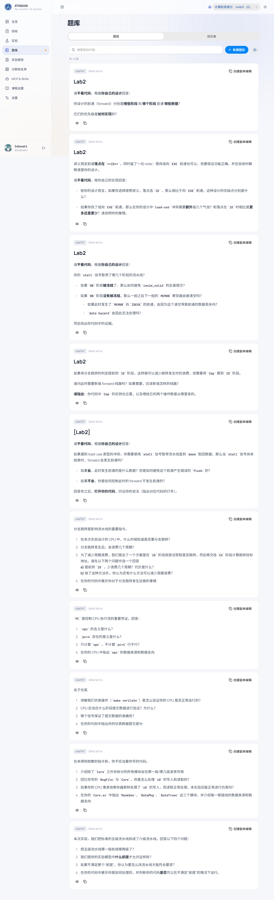
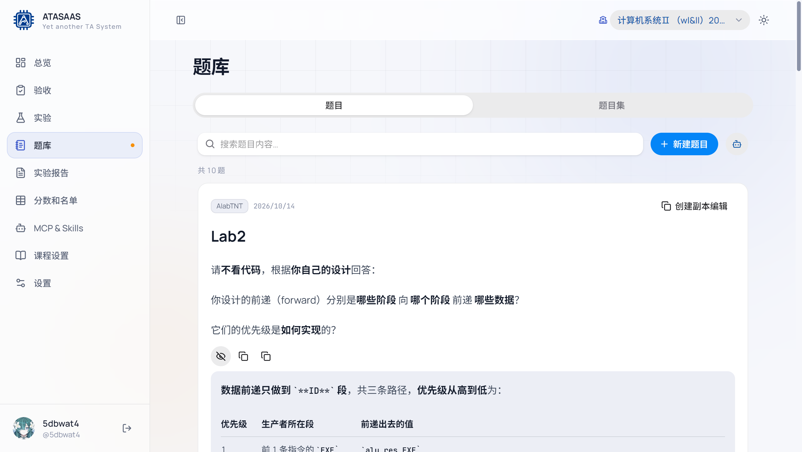
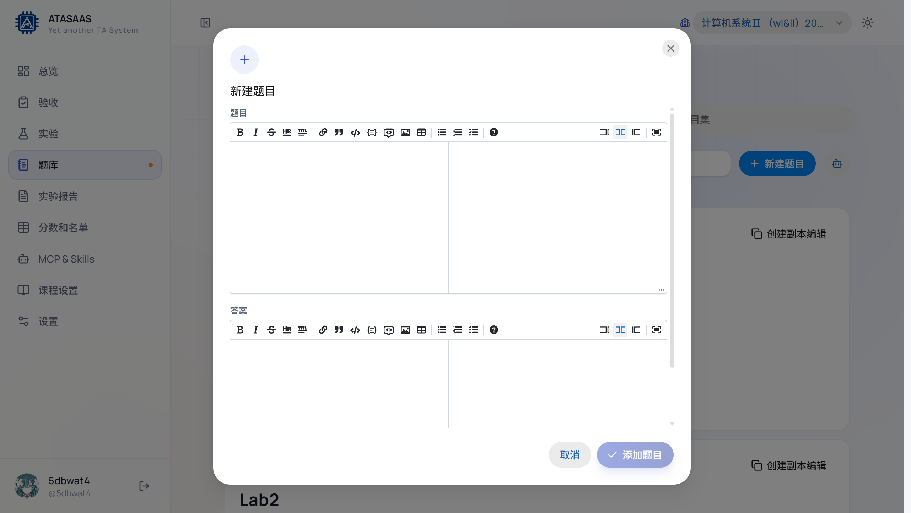
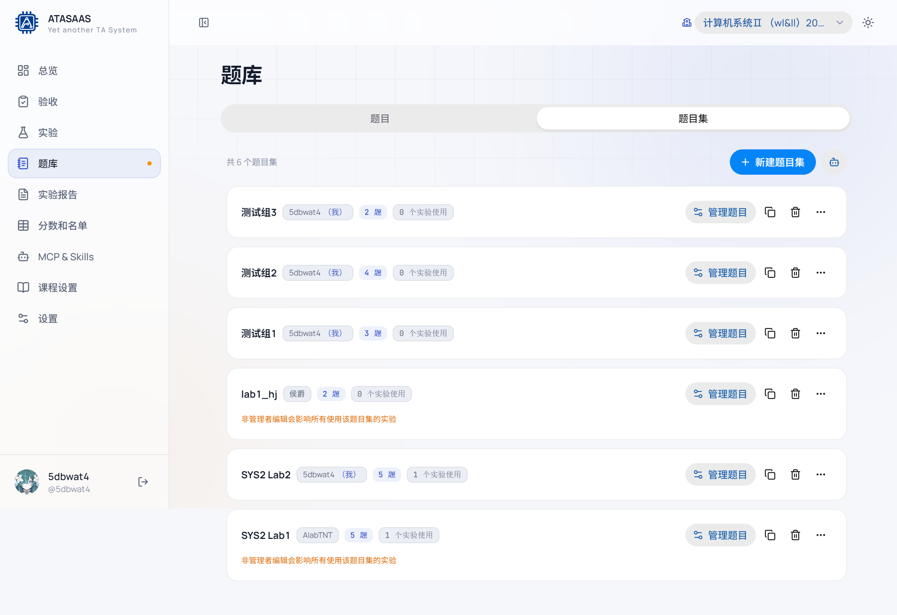
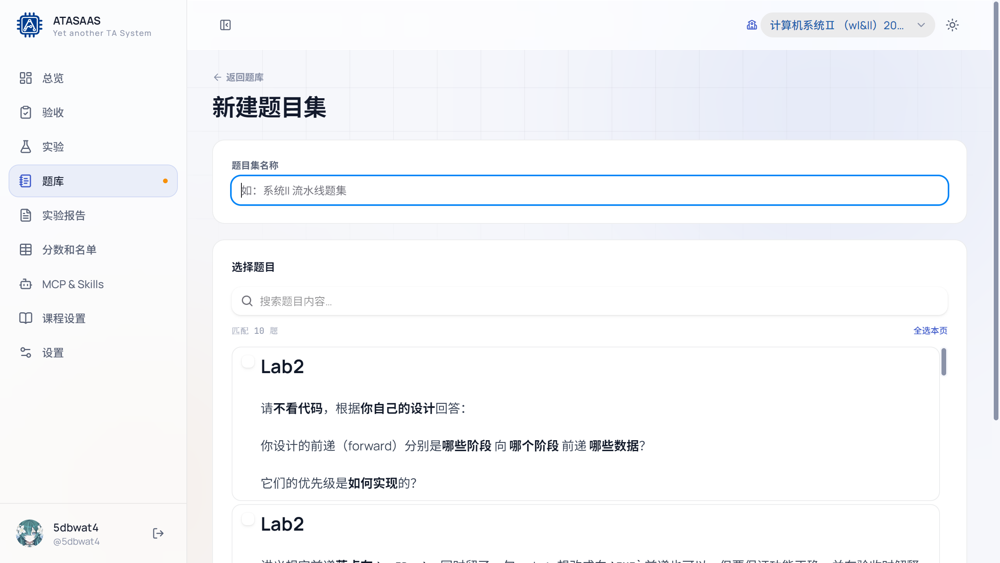
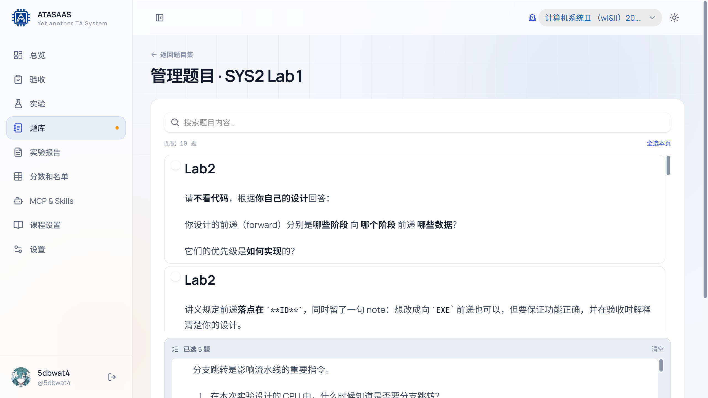

# 5. 题库与题目集

题库分为两层：

- **题目**：独立的问答实体，可以同时属于多个题目集。
- **题目集**：一组题目的有序集合，绑定到实验后作为验收抽题范围。

进入左侧导航「题库」，页面顶部有「题目 / 题目集」两个标签页。

## 5.1 题目列表



- 搜索框按题目内容搜索，输入后自动过滤（有短暂防抖）。
- 显示题目总数，例如「共 10 题」。
- 每张题目卡片显示：命题人、创建/更新时间、题目内容、操作按钮。
- 分页在列表底部，每页 20 题。

### 题目卡片操作

| 操作 | 说明 |
| --- | --- |
| 显示答案 / 隐藏答案 | 展开/收起参考答案 |
| 复制题目 | 复制一份新题目，副本归当前账号所有 |
| 创建副本编辑 | 复制并立即打开编辑窗口（常用于修改他人题目而不影响原题） |

展开答案后的效果：



> 直接编辑他人题目会影响所有引用它的题目集和实验；如果不确定，先「创建副本编辑」。

## 5.2 新建/编辑题目

点击右上角「新建题目」：



编辑窗口包含两个 Markdown 编辑器：

1. **题目**：问题描述，支持标题、列表、代码块、表格、图片、公式等。
2. **答案**：参考答案，供验收时点击「显示答案」查看。

工具栏常用按钮：

- 加粗、斜体、删除线、分隔线。
- 标题、链接、引用、行内代码、代码块。
- 图片、表格、无序/有序/勾选列表。
- 全屏编辑。

两个字段都填写后，「添加题目」按钮才可用。编辑已有题目时，保存后立即生效。

## 5.3 题目集列表

点击「题目集」标签：



每个题目集显示：

- 名称。
- 所有者；如果当前账号是所有者，会显示「（我）」。
- 题目数量。
- 被多少个实验使用。
- 操作：**管理题目**、**复制**、**删除**、**更多操作**。

如果题目集不是当前账号所有，会提示「非管理者编辑会影响所有使用该题目集的实验」。

## 5.4 新建题目集

点击「新建题目集」：



1. 输入题目集名称（必填）。
2. 在下方搜索并勾选题目。
3. 右侧会显示已选题目列表，可调整顺序或移出。
4. 点击「创建题目集」。

也可以从已有题目集「复制」后修改，适合为不同实验准备相似题集。

## 5.5 管理题目集

点击某个题目集的「管理题目」：



- 左侧是可选题库，支持搜索、「全选本页」。
- 右侧显示当前题目集内的题目及顺序。
- 勾选/取消勾选会立即改变右侧列表。
- 右侧题目可以上移/下移或移出。
- 「重置」放弃未保存修改。
- 「保存题目集」保存当前选择与顺序。

题目集的顺序会影响验收抽题时的题目展示顺序；随机抽题则从集合中随机取题。

## 5.6 题目集与实验的关系

- 一个题目集可以绑定到多个实验。
- 实验详情中的「抽题题目集」下拉框用于绑定/解绑。
- 修改被多个实验使用的题目集，会同时影响这些实验的抽题内容。
- 如果只是为某个助教/某个班准备不同的题，建议复制题目集后单独绑定，避免互相影响。

## 5.7 连接你的 Agent

题库页右上角还有「连接你的 Agent」按钮，跳转到 MCP & Skills 页面。通过访问令牌，Agent 可以搜索题目、创建题目、管理题目集等。详见 [MCP & Skills](10-mcp-skills.md)。

## 5.8 使用建议

- 题目和答案都使用 Markdown，代码块建议标注语言（如 ` ```c `、` ```verilog `）。
- 题干写清楚"不看代码/可以看代码"等验收要求。
- 答案不要只写结论，最好包含关键判断点，方便现场快速核对。
- 对共享题目集做批量修改前，先确认「N 个实验使用」的数字。
