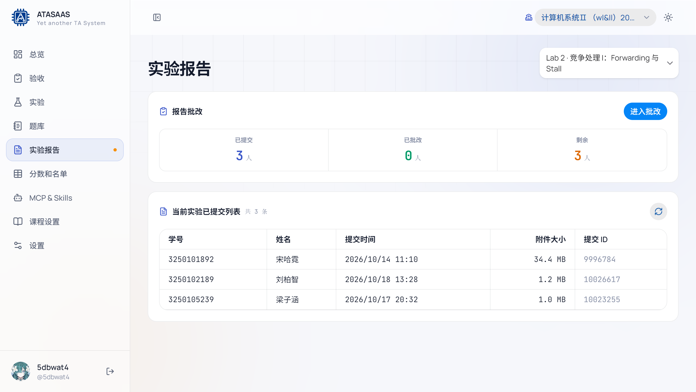
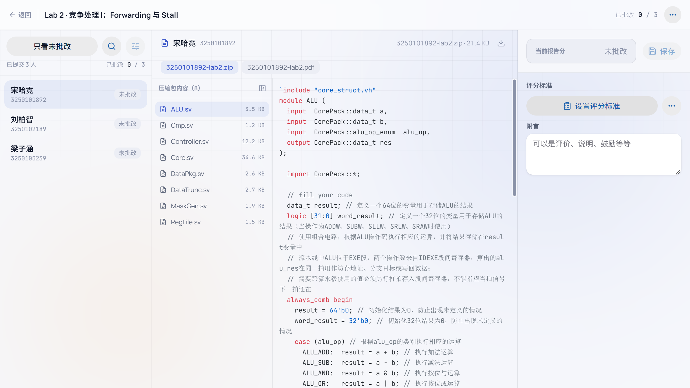
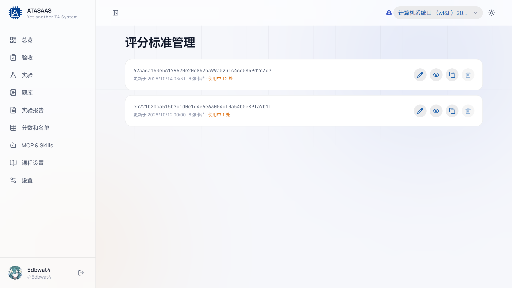
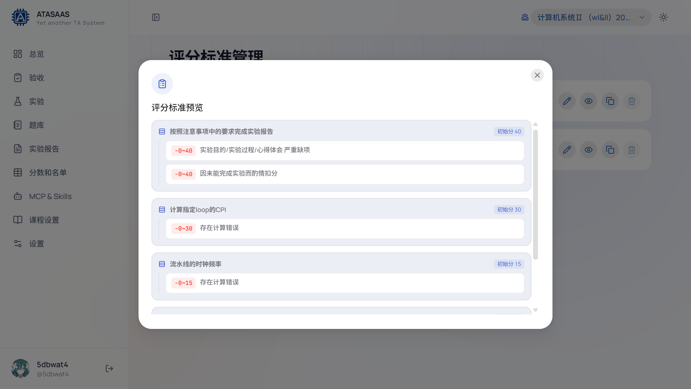
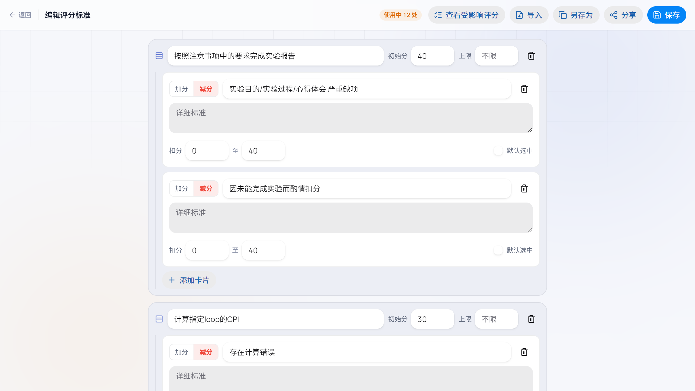

# 6. 实验报告批阅

「实验报告」用于查看学生提交情况、在浏览器里预览附件，并按评分标准给报告打分。

## 6.1 报告总览

左侧导航点击「实验报告」：

页面顶部：

- **实验选择器**：默认选中当前实验，可切换其它实验。
- **报告批改** 卡片：显示已提交、已批改、剩余人数；点击「进入批改」打开批改工作台。
- **当前实验已提交列表**：显示学号、姓名、提交时间、附件大小、提交 ID。
- **刷新**：重新获取提交列表。

> 报告提交列表读取自学在浙大作业。如果获取失败，页面会显示错误提示，但已有的本地评分仍可在成绩页查看。**本手册不演示向上游推送成绩**。

## 6.2 进入批改工作台

点击「进入批改」：

工作台分为三栏：

### 左栏：学生列表

- 顶部显示「已批改 N / 总数」。
- 「只看未批改」：过滤掉已完成的学生。
- 「搜索」：按姓名/学号查找。
- 学生卡片显示姓名、学号和状态（未批改/已批改）。
- 点击学生切换当前批改对象。

### 中栏：附件与预览

- 顶部显示当前学生、学号、压缩包大小和「下载文件」。
- 文件标签：如 `xxx.zip`、`xxx.pdf`。
- 压缩包内容列表：显示 zip 内文件及大小，点击文件预览。
- 预览区支持代码高亮、文本、图片、PDF 等（取决于文件类型）。
- 右上角可以下载原文件。

### 右栏：评分面板

- **当前报告分**：显示当前得分或「未批改」。
- **保存**：保存评分和附言。
- **评分标准**：
  - 显示当前使用的评分标准名称/分享码。
  - 点击「设置评分标准」输入分享码加载，或从评分标准管理页创建/编辑。
- **附言**：填写本次报告的评语，会保存到本地并在学生端/评语模板中使用。

## 6.3 评分标准管理

左侧导航没有单独的"评分标准"入口，但可以从报告批改页进入；对应的管理页路径是 `/console/criteria`。

每条评分标准显示：

- 分享码（48 位十六进制）。
- 更新时间、卡片数量、当前使用处数。
- **编辑**：打开发评分标准编辑器。
- **预览**：查看所有评分项和扣分范围。
- **复制分享码**：复制后可发给其他助教，在批改页加载。
- **删除**：正在使用的标准不能删除（会提示使用中）。

### 预览评分标准

预览页按小节列出：

- 小节标题。
- 初始分。
- 扣分范围（如 `−0~40`）。
- 评语规则。
- 勾选式/范围式评分项。

### 编辑评分标准

编辑器以"小节卡片"组织：

- **小节标题**。
- **初始分**：该小节起评分。
- **上限**：可选，限制最高得分。
- **加分/减分规则**：每条规则包含评语、详细标准、扣分范围、是否默认选中。
- **添加卡片**：新增评分项。
- **删除小节/删除规则**。

顶部操作：

| 操作 | 说明 |
| --- | --- |
| 返回 | 回到评分标准列表 |
| 查看受影响评分 | 查看使用此标准的报告 |
| 导入 | 导入分享码/配置 |
| 另存为 | 复制成新的评分标准 |
| 分享 | 生成/复制分享码 |
| 保存 | 保存修改（会影响使用此标准的所有报告） |

> 修改正在使用的评分标准会影响所有引用它的报告评分。批量调整前建议先「另存为」，再逐步切换。

## 6.4 批改流程建议

1. 在报告列表确认当前实验和提交人数。
2. 进入批改工作台，先设置/加载评分标准。
3. 从「只看未批改」开始，逐个学生：
   - 预览附件；
   - 按评分标准勾选/调分；
   - 填写附言；
   - 点击保存。
4. 左右切换学生，直到「已批改」等于「已提交」。
5. 回到实验详情或学生端核对总评。

## 6.5 常见问题

| 问题 | 说明 |
| --- | --- |
| 提交列表为空 | 该实验未绑定报告作业，或上游暂无提交；确认实验详情里的学在浙大绑定 |
| 预览显示不支持 | 该文件类型不支持在线预览，可先下载到本地 |
| 评分标准加载失败 | 分享码错误或标准已被删除；向标准创建者确认分享码 |
| 保存后学生端没更新 | 刷新学生端；确认保存的是当前学生，且评分标准已加载 |
| 报告分与总评不一致 | 总评按「功能测试/验收问答/报告」权重加权，报告只是其中一项 |
