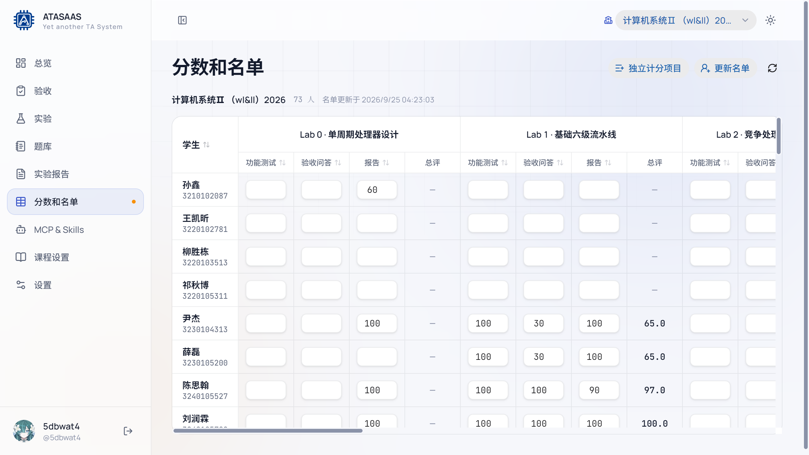
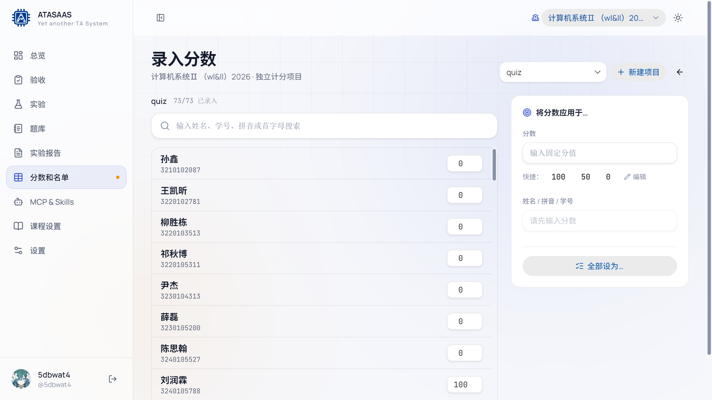

# 7. 分数和名单

「分数和名单」是一个横向可滚动的大表格：每一行是一名学生，每一列是实验的评分项，右侧还有独立计分项目。验收和报告批改写入的分数都会汇总到这里。

## 7.1 页面顶部

- **课程名称 + 学生人数 + 名单更新时间**。
- **独立计分项目**：进入独立项目录入页（见 7.4）。
- **更新名单**：从课程名单获取最新学生，并展示新增/移出的差异，确认后应用。
- **刷新按钮**：重新加载当前成绩数据。
- **按「学生」排序**：按姓名排序；再次点击切换升序/降序。

## 7.2 成绩表结构

每个实验分为四列：

1. **功能测试**
2. **验收问答**
3. **报告**
4. **总评**

- 前 3 列是原始分（0–100，实际允许 -1000~1000）。
- **总评**按课程/实验的评分占比加权计算，不可直接编辑。
- 表头可以点击排序（功能测试/验收问答/报告/总评），没有分数的行始终排在最后。
- 学生列固定在左侧，向右滚动时不会消失。
- 表格右上角有横向滚动条。

### 编辑单元格

1. 点击单元格进入编辑。
2. 输入分数后按回车或点击别处提交。
3. 提交成功会立即写入本地成绩，并提示"分数已更新"。
4. 如果输入超出允许范围，会弹出「分数超出范围」提示，需调整后重试。

因为表格实时同步（多人同时改分时），别的助教更新分数后，当前页面也会自动更新。

## 7.3 更新名单

点击「更新名单」会先**预览差异**，不会直接修改：

- 显示新增学生、移出学生等信息。
- 确认后应用。
- 被移出的学生会从名单中消失，但历史成绩仍保留在数据库中；如果之后重新加入，成绩可以恢复。

如果名单来自学在浙大课程，页面会显示最近一次同步时间；没有同步过时显示"尚未同步"。

## 7.4 独立计分项目

点击「独立计分项目」进入：

用于实验之外的项目，例如 quiz、平时分、bonus 等。

### 选择/新建项目

- 顶部下拉框选择已有项目（如 `quiz`）。
- 「新建项目」创建新的独立计分项目。
- 页面显示 `已录入 / 总人数`。

### 录入分数

- 每行一名学生，可直接在数字框输入分数。
- 右侧有「将分数应用于…」工具：
  - 输入固定分值；
  - 快捷按钮 100 / 50 / 0；
  - 「全部设为…」批量应用；
  - 可按姓名/拼音/学号搜索后应用到指定学生。
- 修改后自动/即时保存，提示"分数已保存"。

> 独立计分项目也会出现在「分数和名单」表格的右侧，但不会参与实验总评，除非课程另有汇总规则。

## 7.5 分数来源

| 分数 | 来源 |
| --- | --- |
| 功能测试 | 验收页第 5 步录入 |
| 验收问答 | 验收页第 5 步录入 |
| 报告 | 报告批改工作台保存 |
| 总评 | 由三项分数按评分占比加权计算 |
| 独立项目 | 「独立计分项目」页面录入 |

## 7.6 注意事项

- 不要在验收/批改尚未保存时刷新页面。
- 总分只是展示值；如需调整，请修改对应的原始分或课程评分占比。
- 如果发现某学生不在名单中，先「更新名单」；仍没有则联系管理员核对课程名单。
- 学在浙大同步/推送入口只用于读取或按管理员流程操作；**本手册不演示推送**。
