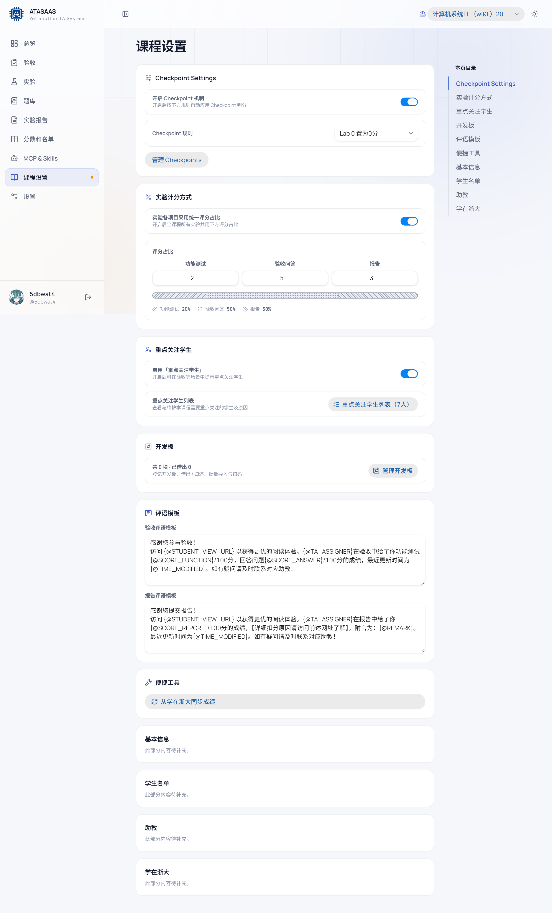
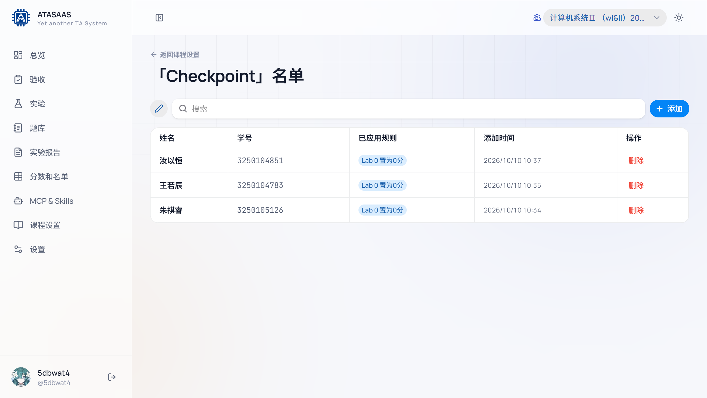
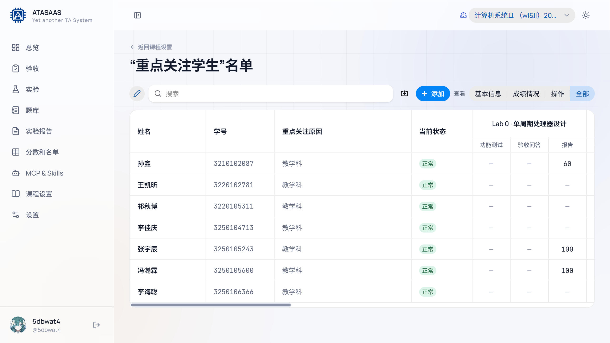
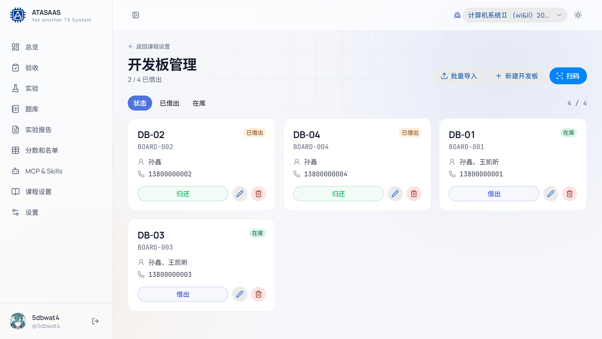

# 8. 课程设置

课程设置是课程级别的配置，影响当前课程下的所有实验、验收和成绩。左侧导航点击「课程设置」。

页面右侧有「本页目录」，可快速跳到各小节。

## 8.1 Checkpoint Settings

用于按规则自动处理 Checkpoint（例如把 Lab 0 置为 0 分）。

- **开启 Checkpoint 机制**：总开关。
- **Checkpoint 规则**：下拉选择规则，例如「Lab 0 置为0分」。
- **管理 Checkpoints**：进入名单页，查看/添加/删除已应用规则的学生。

### Checkpoint 名单

- 搜索学生。
- 表格列：姓名、学号、已应用规则、添加时间、操作。
- 「添加」把学生加入名单并应用当前规则。
- 「编辑」切换批量编辑状态。
- 「删除」将学生从规则名单移除。

> 规则会对名单内学生自动应用判分。加入/移出前请确认规则与本实验的计分口径一致。

## 8.2 实验计分方式

控制功能测试、验收问答、报告三项如何折算总评。

- **实验各项目采用统一评分占比**：
  - 开启：全课程所有实验共用下面的权重，实验详情中的权重只读。
  - 关闭：每个实验可以在实验详情里单独设置权重。
- **评分占比**：三个数字输入框（功能测试、验收问答、报告），下方实时显示折算百分比。
  - 例如 `2 : 5 : 3` → `20% / 50% / 30%`。
- 修改后自动保存；总评会按新比例重新计算。

> 修改统一占比会影响全课程的总评显示，属于高影响操作。调整前建议和教师确认。

## 8.3 重点关注学生

- **启用「重点关注学生」**：总开关；开启后验收等场景会提示。
- **重点关注学生列表**：进入名单页。

名单页功能：

- 按姓名/学号搜索。
- **查看**：
  - 基本信息；
  - 成绩情况；
  - 操作；
  - 全部（默认）。
- 表格显示关注原因、当前状态，以及每个实验的功能测试/验收问答/报告分数。
- **添加**：选择学生并填写关注原因。
- **修改**：编辑关注原因/状态。
- **删除**：移出重点关注名单。

「一键导入（开发中）」暂不可用。

## 8.4 开发板

- 显示当前课程开发板总数、已借出数量。
- **管理开发板**：进入开发板页面。

### 开发板管理

- 顶部统计：`已借出 / 总数`。
- 标签页：**状态（全部）**、**已借出**、**在库**。
- **批量导入**：按模板批量登记开发板。
- **新建开发板**：填写 DB id（必填）、id、联系电话、合用学生。
- **扫码**：通过二维码快速定位/操作开发板。
- 卡片显示：DB id、board id、借出状态、合用学生、电话。
- **借出 / 归还**：切换借出状态。
- **编辑 / 删除**：修改信息或删除记录。

适合实验室硬件借还登记；多人共用一块板时，在「合用学生」中选择多名学生。

## 8.5 评语模板

用于验收/报告保存后生成的通知文本或复制文本。两个模板：

- **验收评语模板**
- **报告评语模板**

支持占位符，例如：

| 占位符 | 含义 |
| --- | --- |
| `{@STUDENT_VIEW_URL}` | 学生成绩查看链接 |
| `{@TA_ASSIGNER}` | 评分助教 |
| `{@SCORE_FUNCTION}` | 功能测试分数 |
| `{@SCORE_ANSWER}` | 验收问答分数 |
| `{@SCORE_REPORT}` | 报告分数 |
| `{@REMARK}` | 附言 |
| `{@TIME_MODIFIED}` | 最近更新时间 |

修改后自动保存。模板只影响生成的文本，不会改变分数。

## 8.6 便捷工具

- **从学在浙大同步成绩**：把上游成绩同步到本地（属于外部同步能力）。请按管理员流程操作；**本手册不演示推送/回写**。

## 8.7 基本信息 / 学生名单 / 助教 / 学在浙大

当前版本这几节显示「此部分内容待补充」。相关操作可以在：

- 个人信息/账号：左侧「设置」；
- 学生名单：在「分数和名单 → 更新名单」；
- 助教：在「设置 → 系统设置」；
- 学在浙大：实验详情中的作业绑定/同步区域。

完成。

## 8.8 修改课程设置的建议顺序

1. 先确认当前课程（顶栏选择器）。
2. 设置评分占比（统一或按实验）。
3. 配置 Checkpoint 规则和名单。
4. 配置重点关注学生。
5. 维护开发板。
6. 最后调整评语模板，避免占位符写错导致通知内容异常。
