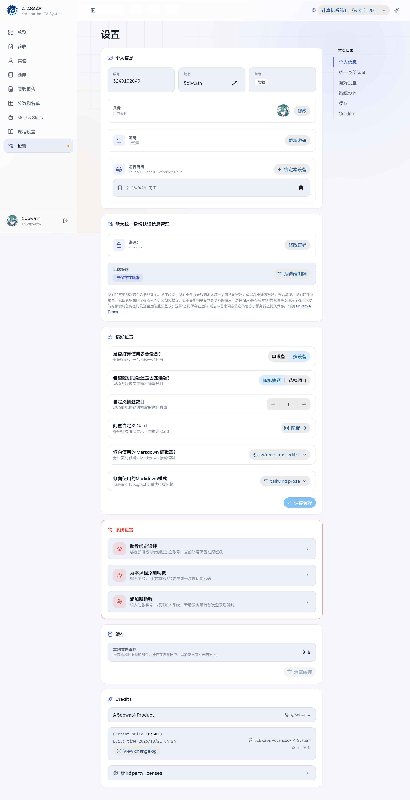
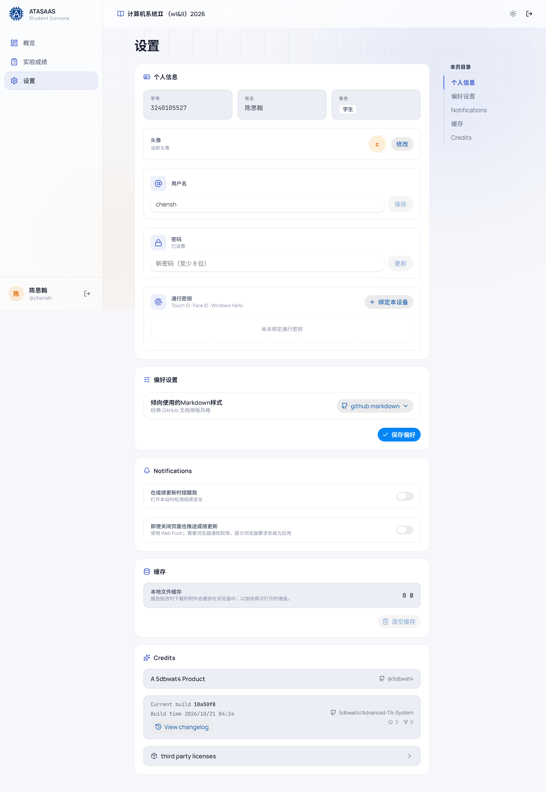

# 9. 个人设置

左侧导航「设置」管理当前账号的登录信息、偏好和系统操作。助教/教师和学生的设置项略有不同。

## 9.1 个人信息

- **学号**：只读。
- **姓名**：只读。
- **角色**：助教/教师/学生。
- **用户名**：点击「修改用户名」可修改；用户名在同班级内唯一。
- **头像**：点击「修改」选择内置头像；不设置时显示姓名首字母。
- **密码**：
  - 未设置时显示「未设置」，可点击「更新密码」设置；
  - 已设置时显示「已设置」，可更新。
  - 密码至少 8 位。
- **通行密钥**：
  - 显示已绑定的设备和绑定时间。
  - 「绑定本设备」按系统提示完成 Touch ID / Face ID / Windows Hello。
  - 已绑定的密钥可以「解绑」。

## 9.2 浙大统一身份认证信息管理（助教/教师）

- 显示当前是否已保存统一身份认证密码（掩码）。
- **修改密码**：更新保存的密码。
- **远端保存**：
  - 「已保存在远端」表示密码保存在服务端，换设备也能使用学在浙大相关功能。
  - 「从远端删除」会删除服务端保存的密码。
- 说明文字解释了本地保存与远端保存的差异：
  - 本地保存：每次使用学在浙大功能时重新登录；
  - 远端保存：密码持久保存在服务器，便于自动同步。
- 相关隐私条款链接：`Privacy & Terms`。

> 如果不需要使用学在浙大同步/推送，可以不提供统一身份认证密码；不影响平台本身功能。

## 9.3 偏好设置（助教/教师）

| 偏好 | 作用 |
| --- | --- |
| 是否打算使用多台设备？ | 单设备：一台完成抽题+评分；多设备：主从协作 |
| 随机抽题 / 选择题目 | 现场验收时随机抽题或手动选题 |
| 自定义抽题数目 | 随机抽题时一次抽几题（1–10） |
| 配置自定义 Card | 跳转到 Card 配置页，详见[验收](4-checkoff.md) |
| Markdown 编辑器 | 选择 `@uiw/react-md-editor` 或 MDX 编辑器 |
| Markdown 样式 | `tailwind prose` 或 `github markdown` |

修改后点击「保存偏好」。部分偏好（如多设备模式）会影响验收页布局。

## 9.4 系统设置（助教/教师）

- **助教绑定课程**：
  - 为当前账号绑定新的班级/课程。
  - 绑定新班级会创建独立账号，当前账号保留在原班级。
- **为本课程添加助教**：
  - 输入学号，创建本班账号并生成一次性初始密码。
  - 适合把一个新助教加入当前课程。
- **添加新助教**：
  - 输入助教学号，将其加入系统。
  - 新助教需要等待首次登录后"解封"（完善信息/设置密码）。
- **缓存**：
  - 显示本地文件缓存大小。
  - 「清空缓存」删除浏览器中缓存的报告附件，不影响服务器数据。

## 9.5 Credits

- 产品署名和作者链接。
- 当前构建版本（commit）和构建时间。
- 「View changelog」查看更新日志。
- 仓库链接和第三方许可证入口。

## 9.6 学生端设置

学生设置页包含：

- 个人信息：学号、姓名、角色、头像、用户名、密码、通行密钥。
- 偏好设置：Markdown 样式。
- **Notifications**：
  - 「在成绩更新时提醒我」：打开本站时检测成绩变化。
  - 「即使关闭页面也推送成绩更新」：使用 Web Push，需要浏览器通知权限；部分浏览器要求把网站安装为应用。
- 缓存：清空本地报告附件缓存。
- Credits。

## 9.7 账号安全建议

- 使用独立密码，不要与统一身份认证密码相同。
- 在个人设备上绑定通行密钥，公共设备不要绑定。
- 使用完公共电脑后点击「退出登录」。
- 不要把访问令牌、统一身份认证密码发给他人。
