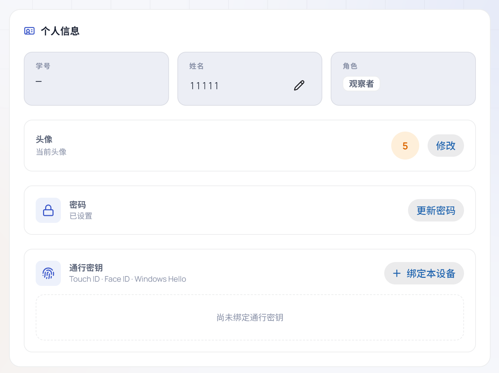
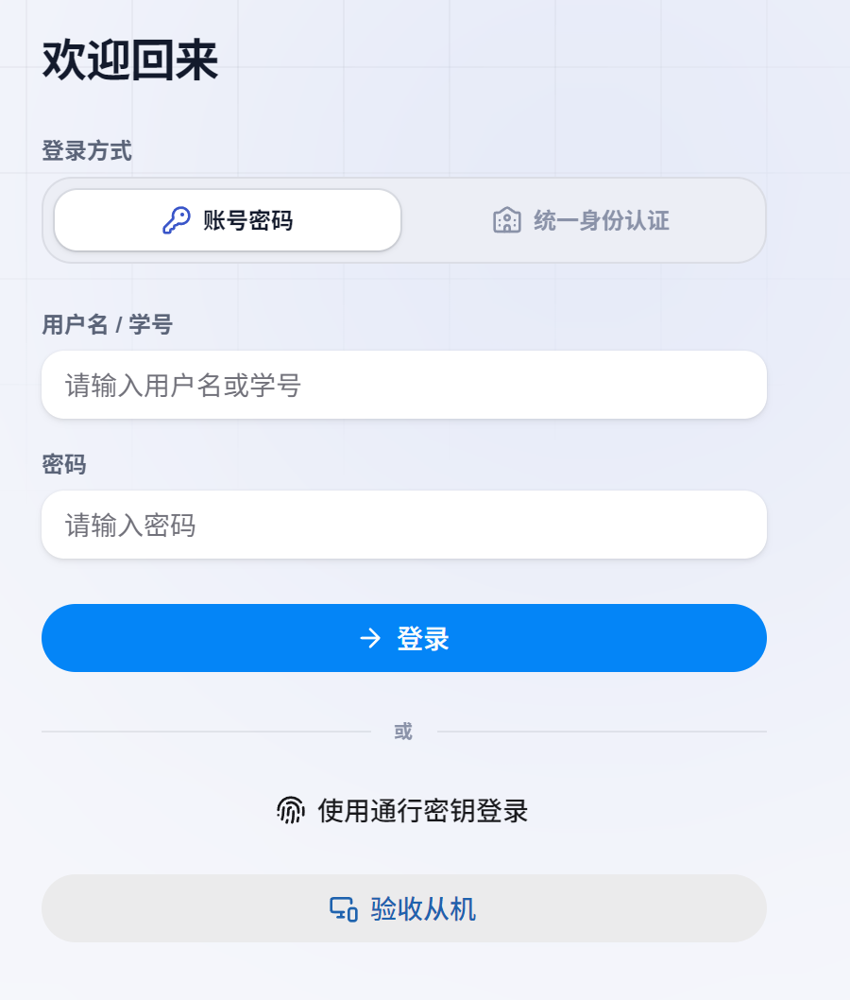

总而言之，与你的身份信息有关的字段是：

- 你的用户名
- 你的姓名
- 你保存的密码
- 你的学工号
- 你的webauthn通行密钥
- 你保存的浙大统一身份认证密码，你的头像，你的角色（这三者在这篇文章中没啥用）

在你注册的时候，你一定提供了你的用户名；此外，你应当至少提供了学工号和密码之一。

# 我有哪些登录方式，每个登录方式分别是怎么作用的？

登录方式一：你使用你的**用户名**+你保存的**密码**进行登录，

登录方式二：使用浙大统一身份认证登录  
- 正如我一直在各个文档中强调的那样，我不推荐这种登录方式。因为我们暂时没有获得浙大统一认证的SSO能力，因此使用这种方式登录时，你需要将自己的学工号和浙大统一身份认证密码发送服务器，后端会登录并验证你的身份。
  - 我们保证不会存储你的统一身份认证信息
  - 我们只会请求：
    - 一次学在浙大的身份信息接口（用于确认你的身份信息）
    - 以及一次课程列表接口（如果检测到你拥有某个课程的助教身份，且该课程已经在本系统中注册，我们会自动授予你系统中的助教账号）
  - 我们保证上述两个请求的响应也不会在服务器中被存储。

# 在注册时，我需要深思熟虑自己的用户名或学号吗？

可能确实。这两个信息一旦确认无法更改。

# 在注册时，我需要深思熟虑自己的密码或姓名吗？

登录完成后，你随时可以访问“设置->个人信息”修改自己的姓名或密码。

**建议使用不同于你常用工具的密码，且建议你使用强密码**

# webauthn / 通行密钥登录分别是什么方式？我怎么好像没见到

后续webauthn和“通行密钥”指代同一个东西

受限于webauthn规范，你需要先有一个账户然后才能绑定webauthn。因此，如果你尚无用户名，那么在注册时不会提示webauthn绑定。

无论如何你都可以在自己的个人信息页重新绑定通行密钥。

顺便一提，通行密钥通常是给人当2FA用的，当然也有人把它当做正常的登录流程使用（比如谷歌）。当然，这个只是技术小故事了

# 我忘记了自己的密码怎么办？

如果你在注册时绑定了学工号，那么你可以使用统一身份认证登录，登录后你可以修改密码。

你也可以联系ATASAAS实例的维护者（@5dbwat4, me@5dbwat4.top），他会帮助你重置密码。

# 话说，你之前说的那个“你保存的浙大统一身份认证密码”是什么意思？

对于助教的情况，获取学生提交的资源、将成绩与评语推送至上游都需要登录你的学在浙大账号，因此，对于这种情况，你需要保存浙大统一身份认证密码。

我们**默认不会**保存你的浙大统一身份认证密码，对于非助教的情况，保存该密码也是没有意义的。

对于已保存浙大统一身份认证密码的助教，我们会尽量安全地存储你的统一身份认证密码（至少不会明文落盘存储），你也可以随时从数据库中移除该信息。