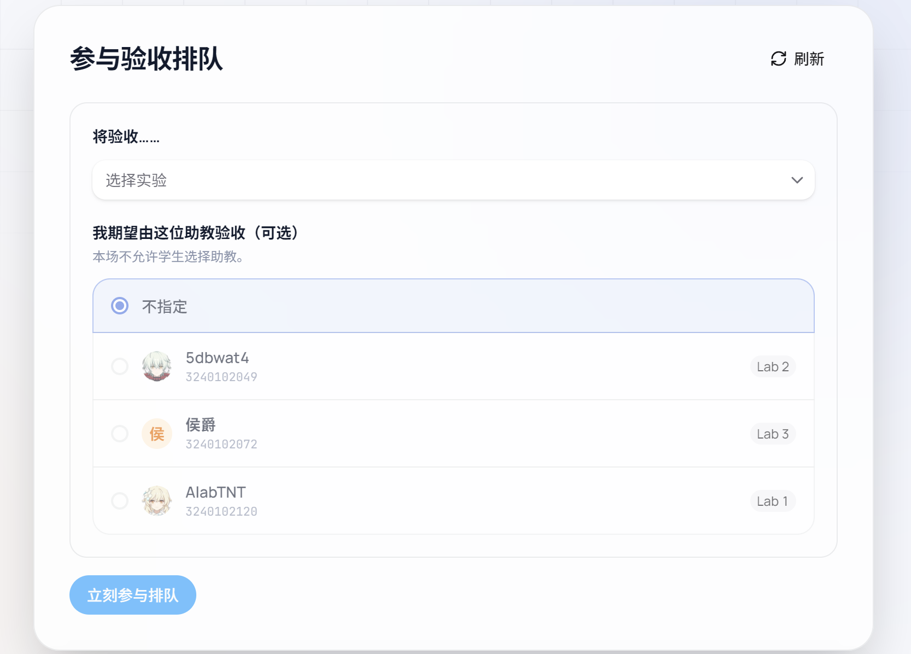

# 学生侧

点击工具栏中的“验收排队”，可以进行验收排队。

学生需要选择自己想要验收的实验，以及想要验收的助教，点击立刻参与排队，将会纳入队列。

下方显示的则是当前队列，~~效果与钉钉的贴表情非常相似呀不是吗~~。

与钉钉的贴表情一样，
- 贴完表情后你可以取消表情，在队列中你也可以退出排队
- 除此以外，你还可以手动拖动将自己的位次后挪

助教会向你发出“预叫号”，此时你应当做好验收准备，设计上在3~5分钟内将轮到你验收。如果你不方便参与验收，可以直接取消排队，或者将位次后挪。一旦你进行此操作，预叫号状态将结束。

