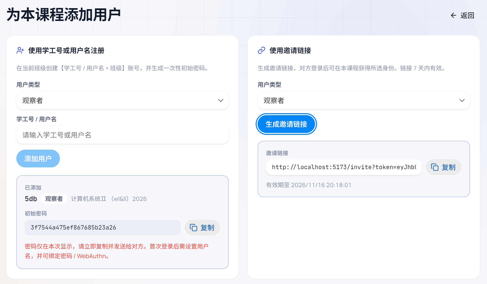
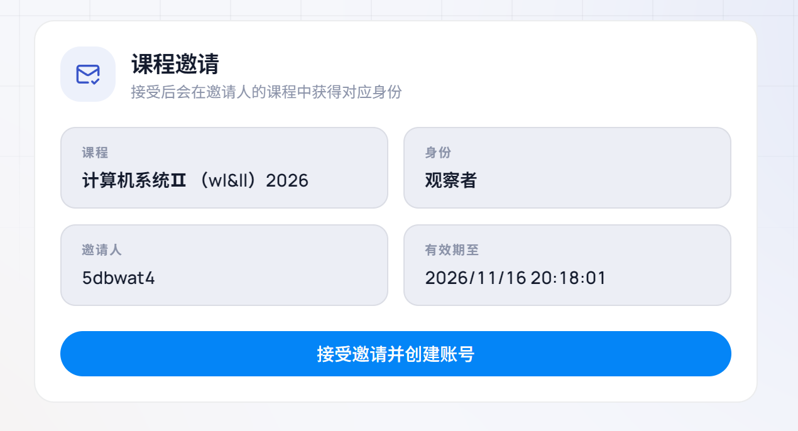
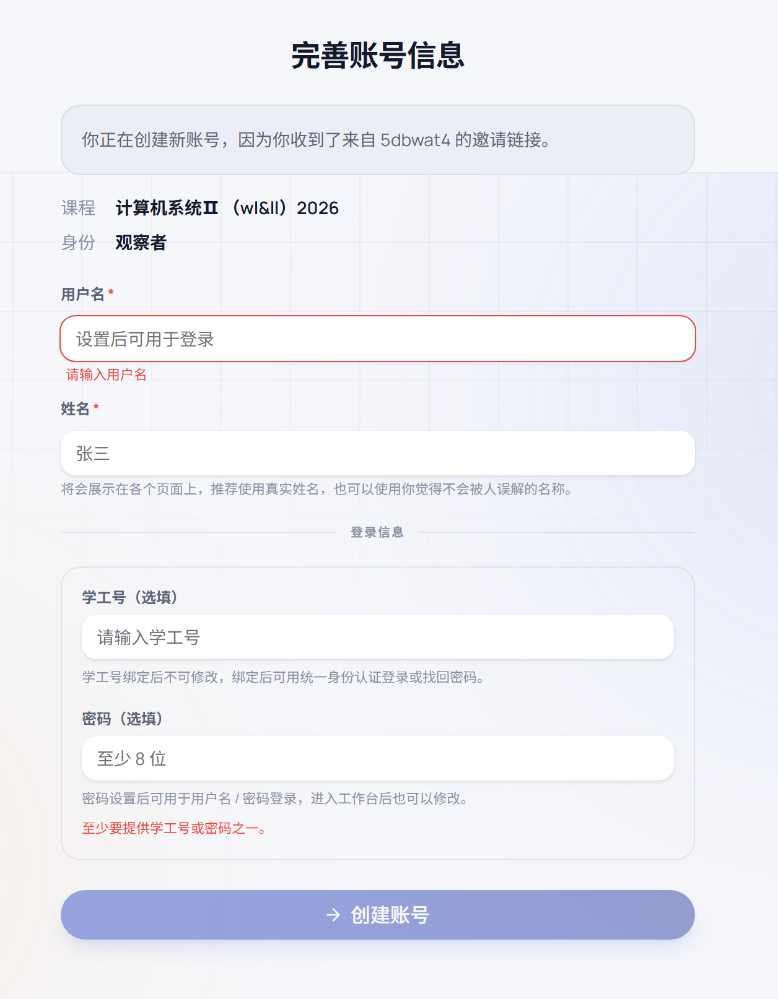

# 如何为你的课程添加一个新的成员

首先需要你是一位助教。

请你访问该页面：https://atasaas.5dbwat4.top/console/courses/users/new （设置->为本课程添加用户）

左侧面向的情况是，你知道对方的学工号或期待的用户名，然后你可以直接生成一个账户，告知对方后对方使用这个用户名密码登录

右侧面向的情况是，你不知道对方的学工号，那么你可以生成一个邀请链接，让对方根据邀请链接进行注册，对方注册完成后会自动按照此身份进入此班级

**我推荐使用右侧的邀请链接方案。**

# 我收到了别的助教发来的这个链接，我该怎么办？

如果你觉得没有问题，就点击接受邀请。

**如果你在这个系统里没有账号，或者你不希望沿用先前的账号，那么您应当先退出登录再接受邀请；如果你希望沿用先前的账号，那么你应当先登录再接受邀请**，换句话说，我们存在一个用户名唯一的要求，具体是：(用户名,课程)是唯一的。但是既然这样的话，如果我用一个用户名登录后，系统怎么知道我想要登录哪个课程呢？此时系统会展示一个“选择登录的课程”页面。为了避免不同的用户课程串起来，我们要求新用户的用户名，不可以与已有用户的用户名相同；如果新用户已有一个登陆态，那么我们允许他可以使用自己已有的用户名。

总而言之，如果你没有什么洁癖的话，这一部分对你没有什么影响，现在你应该开始完善账号信息。

- 用户名是一个唯一的字符串，可以被用于登录
- 姓名是另一个字符串，会展示在系统中，例如学生看到的“验收人”栏目，验收题目的“命题人”栏目。推荐使用真实姓名，也可以使用你觉得不会被人误解的名称。进入系统后还可以再修改。

登录信息则决定了您可以如何登录。

- 如果你填写了学工号，那么你可以通过“浙大统一身份认证方式”登录
  - **除非你是助教，否则我们不推荐这个登录方式**，因为使用该登录方式需要将您的学工号和密码发送至服务器端，虽然我们保证不会存储该信息或挪作他用，但这件事总归是非常annoying的。
  - 不过还是**建议填写一下这个信息**，因为如果你忘记了密码，学工号将成为你找回密码的手段。
- 如果你填写了密码，那么你可以“使用用户名和密码登录”。请保管好你的密码。
  - 我们会使用业内常规的方式保护你的密码。

你至少要提供学工号或密码之一，否则创建账号后你将无法登陆。