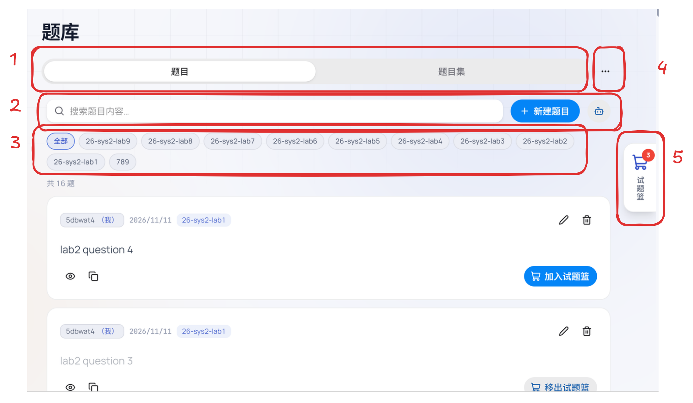

验收问题的最小单位是题目。

可以将多个题目组成一个题目集，然后可以在实验页面设置绑定题目集，题目集是验收的单位。

相当于是：问题 <-M:N-> 题目集 <-1:1-> 实验（验收）  
~~妈的，数据库系统还在追我~~

试题篮是一个中间介质，来优化创建题目集的体验。

# 关于tag

设定上，他用来标记题目所在的lab，这样同一个课程的不同平行班可以使用它来为自己的课程选择题目。

举个例子，计算机系统现在有X、Y、Z三个平行班，X班级助教为lab1~4分别都命制了5道题目，那么现在题库里一共有20道题目怎么区分呢？助教可以给这些题目打上tag，例如`26-sys2-lab1`这样。我的设计是：

- 相同平行班的人可以直接把“26-sys2-lab1”全部添加进自己的题库
- 明年平行班的人也可以把它添加进自己的题库，同时还可以再额外写一些“27-sys2-lab1”的题目来添加题库

不过tag具体怎么写不是定死的，如果你有更好的思路，欢迎与我交流。

点击页面上具体的tag可以进入这个tag对应的页面

## 如何添加一个新tag

点击区域4的ellipsis按钮，dropdown中选择“管理tag”，可以进入tag管理页。

在这个页面可以对tag进行添加，删除，重命名

# 关于题目

一个题目包含以下信息：  
- 题目和答案
- 发布者和发布时间
- tag

题目和答案均支持Markdown语法。题目在验收时会被学生看到。

点击新建题目可以创建题目。

在题库点击新建题目时，无论是否开启了筛选都不会自动填充tag字段；  
在tag页点击新建题目时，会自动填充tag字段为当前所在的tag

一个题目可以有多个tag，一个题目可以被多个题目集绑定。

# 关于题目集

在题库点击题目集可以新建题目集。

一个题目集包含以下信息：  
- 它的名称和它的tag
- 包含的题目
- 创建者
- 创建时间

题目集也有一个tag，这个tag是与题目的tag共用的。

对于“给题目集选择题目”这件事，说实话，我没有想出一个非常优美的解决方案，现在给的方案是你可以通过tag去批量选择题目，然后你也可以搜索题目并选择。但是相比而言，**我最建议的是使用试题篮选择题目**。

# 谁能编辑他们？

**这一部分的设定我个人感觉还是有问题的**，后续等我灵感爆发了再改吧。

- 对于题目，因为同一个题目可能被不同的题目集使用，因此，一个人不能修改别人的题目。
  - 怎么设计最主要的意图是考虑了这样一个情况：一年过去了，课改题目发生了一些微小的变化，于是乎后来的助教直接就着前人的题目做修改，我不希望这样的情况发生并期待每一年的题目都能被保留（作为一种历史记录）。
- 但是你可以为一个题目创建副本并编辑
- 对于题目集，我们不建议你编辑别人的题目集，但最好别这么做。
  - 我们考虑了另外一个情况：一位助教发现另一位助教命制的题目有问题，他该怎么改？
    - 他可以为那道题目创建副本，修改后对每一个使用了该题目的题目集更新题目
    - 他也可以告知那位助教，让那位助教修改
  - 那为什么我们不直接让题目集彻底独立开来，不共享题目呢？
    - 我们考虑这样一个情况：三个平行班里有一位助教相对比较负责（亦或者是三个班的助教开了个会议确定了指定的同样的题目）。在这种情况下，只要有一位助教录入题目，别的平行班助教只要选题即可
    - 此时如果录入题目的助教后来又发现题目出现了问题，他只要直接修改题目就可以让更改同步至所有平行班的验收题目中

# 试题篮功能

这是我某一天突发奇想想出来的方案，我个人认为基本彻底解决了给题目集选择题目的困难性。解决方法就是把选择题目这件事提前。

感谢组卷网 https://zujuan.xkw.com/ 我在高中的时候一直依赖它上面的题目，真想不到到了大学我还要从这个东西上汲取灵感。

本功能于2020年11月11日实现。

以上是闲话。

试题篮是一个跨页面、持久化的状态。

所有题目均有**添加到试题篮**功能，无论是你新命制的题目，别人已经选好了的题目集中的题目，还是tag中的题目。

你可以非常轻松地在正常的浏览题目的过程中，将题目添加至试题篮。

等你觉得足够的时候，打开右侧试题篮浮窗，

- 点击“直接去验收”（尚未实现，不推荐）：直接使用这一批试题进行验收
- 点击“去组卷”：进入创建题目集的页面，题目已经默认选好，你只需要标一下tag，编辑一下题目集名称即可。

点击删除，可以从试题篮中移除题目。

## 为什么叫“去组卷”，我们哪有组卷的事？

一点小巧思，一点小致敬罢了。

# 常见场景

## 明天就要验收了，但是我还没有准备题目集（其实题目也没准备）

1. 此时你应该为实验创建一个tag，
2. 在tag对应的页面点击创建题目，编辑你的题目，然后点击“保存并加入试题篮”
3. 等你把这些题目全部出完，点击试题篮->去组卷
4. 编辑一个合适的题目集名字，然后点击保存

我个人认为这个流程还是相当无痛的，包括没有非常让人恼火的重复的寻找阶段（比如寻找tag或者寻找题目）；唯一的问题是“创建题目”可能要重复点击几次，对于这一点，我们后续打算增加快捷键支持。

