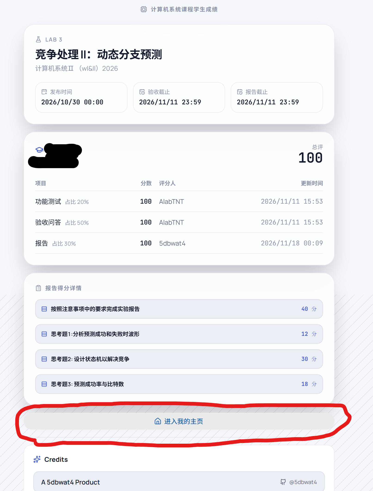
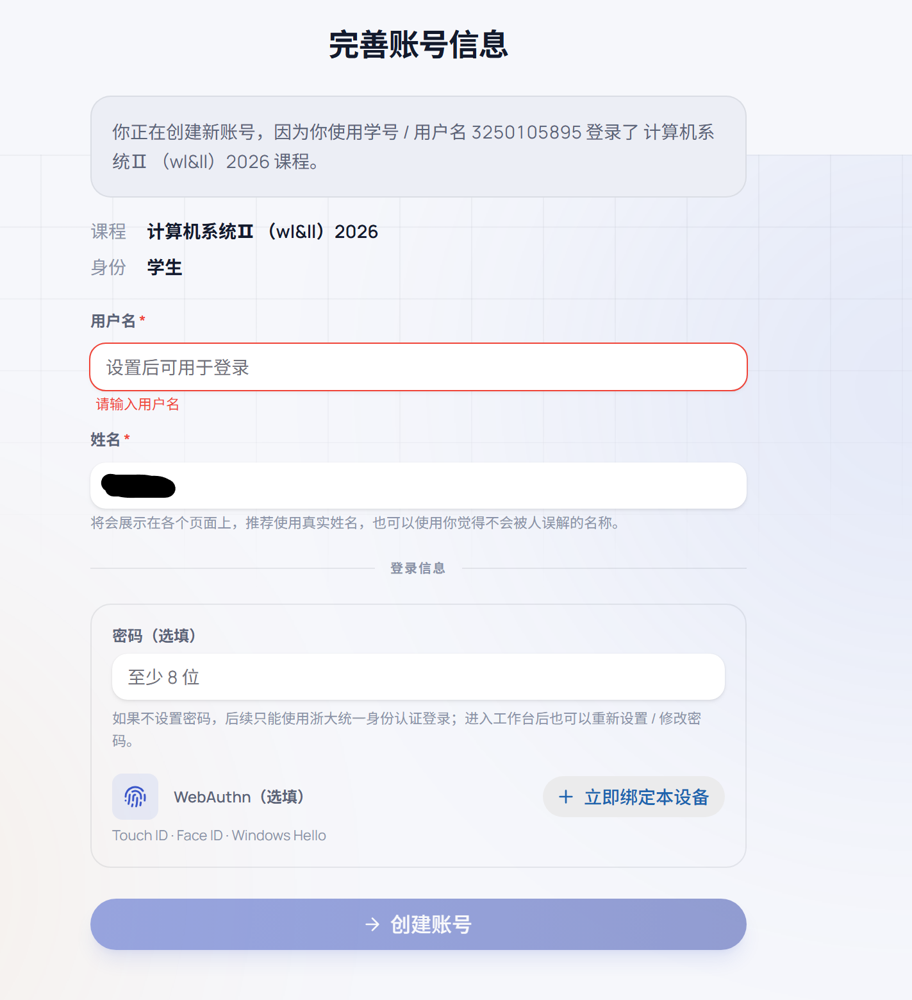

我们最推荐的流程是这样的：

- 你可以打开学在浙大，找到任意一个你已经提交且被批改的作业
- 找到其中的评语部分，通常如下所示：
  “感谢您参与验收！访问 https://atasaas.5dbwat4.top/student-preview/view?token=xxxxxxxxxxxxxxxxxx 以获得更优的阅读体验。AlabTNT在验收中给了你功能测试100/100分，回答问题100/100分的成绩，最近更新时间为2026/11/18 00:09。如有疑问请及时联系对应助教！”
- 在评语中应当会包含一个链接，你需要完整复制，并在浏览器中打开它
  
- 在所有成绩的下面有一个“进入我的主页”按钮
- 
  你现在需要创建自己的账户，用户名的要求：任意常用用户名均可，后续会作为你的登录凭据。  
  下方的密码也建议你填写，这样后续你就可以通过用户名和密码登录。  
  特别需要你注意的是：此处的密码不是你的浙大统一身份认证密码。
- 然后你将可以进入主页

后续你可以在登录页使用你刚才设置的用户名和密码进行登录。

----

你也可以使用自己的学号和统一身份认证密码登录系统。
- 正如我一直在各个文档中强调的那样，我不推荐这种登录方式。因为我们暂时没有获得浙大统一认证的SSO能力，因此使用这种方式登录时，你需要将自己的学工号和浙大统一身份认证密码发送服务器，后端会登录并验证你的身份。
  - 我们保证不会存储你的统一身份认证信息
  - 我们只会请求：
    - 一次学在浙大的身份信息接口（用于确认你的身份信息）
    - 以及一次课程列表接口（如果检测到你拥有某个课程的助教身份，且该课程已经在本系统中注册，我们会自动授予你系统中的助教账号）
  - 我们保证上述两个请求的响应也不会在服务器中被存储。