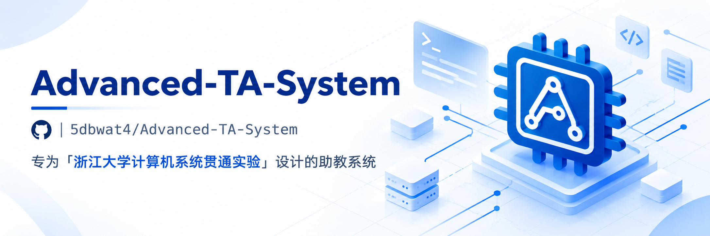

# Advanced TA System — Frontend

Web console for **Advanced TA System**, a teaching-assistant system built for the *Zhejiang
University Computer Systems* lab courses (checkoff, grading, rosters, reports).

React 19 + TypeScript + Vite SPA. Talks to the Fastify backend over REST and
Socket.IO; the backend lives in [`../be`](../be).

## Tech stack

- **Framework**: React 19, TypeScript, Vite 8 (Rolldown), React Router 7
- **UI**: HeroUI v3, Tailwind CSS v4, `next-themes` (light/dark), `motion`
- **State / data**: `zustand`, `socket.io-client`, `sonner` (toasts)
- **Domain libs**: MDX / Markdown editors, KaTeX + `react-markdown`, CodeMirror
  languages, `pdfjs-dist`, `exceljs`, `fflate`, `isomorphic-git`, `pinyin-pro`
  (name search), `@zxing` (QR scan), `qrcode.react`, `@simplewebauthn/browser`
- **Icons**: `unplugin-icons` over `@iconify-json/lucide` (no auto-install)
- **Lint**: `oxlint`

## Scripts

```bash
pnpm dev        # dev server on :5173
pnpm build      # tsc -b && vite build
pnpm lint       # oxlint
pnpm preview    # preview the production build
```

Run from the monorepo root with `pnpm dev:fe` / `pnpm build:fe` instead.

## Layout

```
src/
  pages/        route-level screens (lazy-loaded)
  components/   UI building blocks (ui/, checkoff/, reportgrade/, settings/, ...)
  lib/          api client, stores, realtime, formatting helpers
  content/      static content (changelog, terms, credits)
```

## Features

- Dashboard, per-class experiments and timelines
- Scores & rosters, plus a standalone scored-project entry page
- Report grading with reusable rubrics (criteria) and per-student remarks
- Question banks and checkoff questions
- Multi-device **checkoff**: a master screen broadcasts questions to slave terminals
  that join via a 6-digit code; presence and connection status are shown live
- Checkin screens for slave terminals (`/checkin`, `/checkin/:token`)
- Dev board lending/borrowing with QR scanning
- Focus students, reports, and push/pull sync with the upstream course system
- Course/staff/access-token/ZJU-account settings, an MCP connector page, changelog
  and license pages

## Build & loading

The production build is post-processed by two local Vite plugins:

- `plugins/loading.ts` — strips the entry `<script>`/`<link>` tags, emits a
  `manifest.json` + content-hashed `loader.js` + a service worker `sw.js`, and
  injects an inline progress shell. The service worker precaches static assets and
  uses a version hash (baked into `sw.js`) to gate updates; users are prompted to
  refresh rather than being reloaded silently.
- `plugins/html-minify.ts` — minifies the final `index.html` (and collapses the
  blank lines left behind by stripping the entry tags).

Routes are code-split, and dependencies are split per package for stable, cacheable
chunks.

## Development

`vite.config.ts` proxies `/api`, `/socket.io` and `/mcp` to `http://localhost:3001`,
so run the backend (`pnpm dev:be`) alongside `pnpm dev`.

---

A 5dbwat4 Product · [github.com/5dbwat4](https://github.com/5dbwat4)
